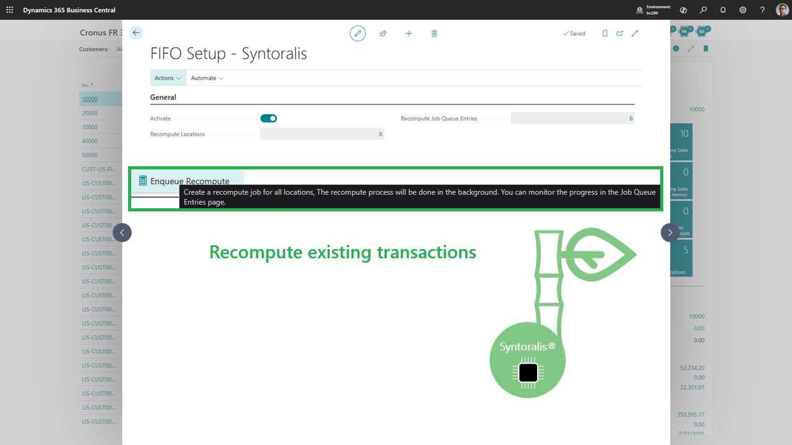
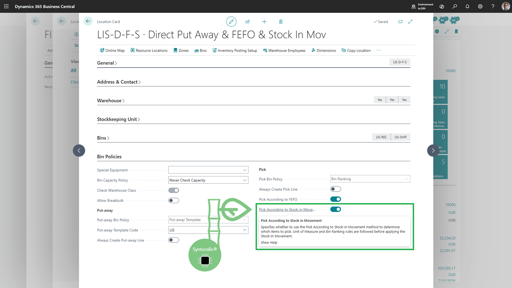
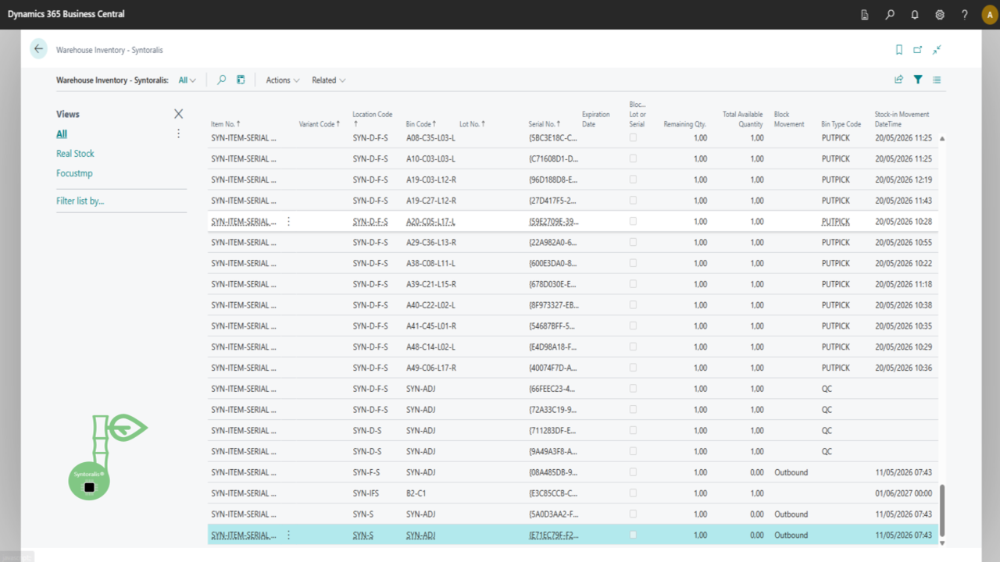
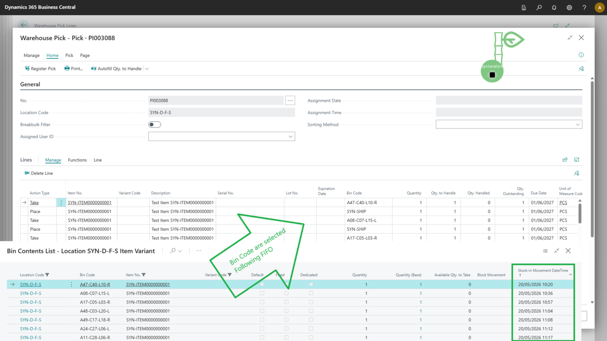

#  Syntoralis FIFO Logistic
 
<table>
<tbody>
<tr><td><strong>Product</strong></td><td>Syntoralis FIFO Logistic</td></tr>
<tr><td><strong>Publisher</strong></td><td>Syntoralis EURL</td></tr>
<tr><td><strong>Version</strong></td><td>1.0.0.57</td></tr>
<tr><td><strong>Platform</strong></td><td>Microsoft Dynamics 365 Business Central 27.0+ (Cloud)</td></tr>
<tr><td><strong>Datasheet date</strong></td><td>29/10/2026</td></tr>
<tr><td><strong>License</strong></td><td>Proprietary</td></tr>
<tr><td><strong>Documentation</strong></td><td><a href="https://syntoralis.github.io/BCApps/syntoralis-fifo-logistic/">Online documentation</a></td></tr>
<tr><td><strong>Marketplace</strong></td><td><a href="https://marketplace.microsoft.com/en-us/product/PUBID.syntoraliseurl1775292660785%7CAID.syntoralis-fifo-logistic%7CPAPPID.11dc3515-69b5-4008-b250-fb7b76a7f281">Product page on Microsoft Marketplace</a></td></tr>
</tbody>
</table>

<strong>Promise:</strong> Pick the oldest stock, automatically, across all your warehouse processes. Reduce stock ageing, eliminate allocation errors and stay compliant in all circumstances - without changing your Business Central processes.

### Table of contents

<a href="#sec1"><svg viewBox="0 0 20 20" width="36" height="36" style="vertical-align:-6px" xmlns="http://www.w3.org/2000/svg"><path d="M4 2h9l4 4v12a1 1 0 0 1-1 1H4a1 1 0 0 1-1-1V3a1 1 0 0 1 1-1z" fill="none" stroke="#1B5E20" stroke-width="1.4"/><path d="M13 2v4h4" fill="none" stroke="#1B5E20" stroke-width="1.4"/><line x1="6" y1="9" x2="15" y2="9" stroke="#1B5E20" stroke-width="1.1"/><line x1="6" y1="12" x2="15" y2="12" stroke="#1B5E20" stroke-width="1.1"/><line x1="6" y1="15" x2="12" y2="15" stroke="#1B5E20" stroke-width="1.1"/></svg> General overview</a>
<a href="#sec2"><svg viewBox="0 0 20 20" width="36" height="36" style="vertical-align:-6px" xmlns="http://www.w3.org/2000/svg"><circle cx="10" cy="10" r="8" fill="none" stroke="#1B5E20" stroke-width="1.6"/><path d="M6 10.5l3 3 5.5-6.5" stroke="#1B5E20" stroke-width="2" fill="none" stroke-linecap="round" stroke-linejoin="round"/></svg> What does physical FIFO solve?</a>
<a href="#sec3"><svg viewBox="0 0 24 24" width="36" height="36" style="vertical-align:-6px" xmlns="http://www.w3.org/2000/svg"><path d="M9.401 3.003c1.118-1.36 3.081-1.36 4.199 0l.399.487c.316.385.803.59 1.296.546l.627-.055c1.74-.153 3.204 1.31 3.05 3.05l-.055.627a1.63 1.63 0 0 0 .546 1.296l.487.399c1.36 1.118 1.36 3.081 0 4.199l-.487.399a1.63 1.63 0 0 0-.546 1.296l.055.627c.153 1.74-1.31 3.204-3.05 3.05l-.627-.055a1.63 1.63 0 0 0-1.296.546l-.399.487c-1.118 1.36-3.081 1.36-4.199 0l-.399-.487a1.63 1.63 0 0 0-1.296-.546l-.627.055c-1.74.153-3.204-1.31-3.05-3.05l.055-.627a1.63 1.63 0 0 0-.546-1.296l-.487-.399c-1.36-1.118-1.36-3.081 0-4.199l.487-.399a1.63 1.63 0 0 0 .546-1.296l-.055-.627c-.153-1.74 1.31-3.204 3.05-3.05l.627.055a1.63 1.63 0 0 0 1.296-.546l.399-.487z" fill="none" stroke="#1B5E20" stroke-width="1.4"/><circle cx="12" cy="12" r="3" fill="none" stroke="#1B5E20" stroke-width="1.4"/></svg> The solution: automated physical FIFO</a>
<a href="#sec4"><svg viewBox="0 0 20 20" width="36" height="36" style="vertical-align:-6px" xmlns="http://www.w3.org/2000/svg"><polygon points="10,2 12.4,7.5 18.5,8 14,12 15.3,18 10,15 4.7,18 6,12 1.5,8 7.6,7.5" fill="#1B5E20"/></svg> Key benefits</a>
<a href="#sec5"><svg viewBox="0 0 20 20" width="36" height="36" style="vertical-align:-6px" xmlns="http://www.w3.org/2000/svg"><circle cx="7" cy="6" r="2.6" fill="#1B5E20"/><path d="M2 17c0-3 2.2-5 5-5s5 2 5 5" fill="#1B5E20"/><circle cx="15" cy="7" r="2" fill="#1B5E20"/></svg> Who is it for?</a>
<a href="#sec6"><svg viewBox="0 0 20 20" width="36" height="36" style="vertical-align:-6px" xmlns="http://www.w3.org/2000/svg"><rect x="3" y="3" width="14" height="14" rx="2" fill="none" stroke="#1B5E20" stroke-width="1.4"/><path d="M6 7l1.5 1.5L10 6" stroke="#1B5E20" stroke-width="1.4" fill="none" stroke-linecap="round" stroke-linejoin="round"/><line x1="11" y1="7.5" x2="14" y2="7.5" stroke="#1B5E20" stroke-width="1.2"/><path d="M6 11l1.5 1.5L10 10" stroke="#1B5E20" stroke-width="1.4" fill="none" stroke-linecap="round" stroke-linejoin="round"/><line x1="11" y1="11.5" x2="14" y2="11.5" stroke="#1B5E20" stroke-width="1.2"/></svg> Key features</a>
<a href="#sec7"><svg viewBox="0 0 20 20" width="36" height="36" style="vertical-align:-6px" xmlns="http://www.w3.org/2000/svg"><path d="M15 5A6 6 0 1 0 13 14" stroke="#1B5E20" stroke-width="1.6" fill="none" stroke-linecap="round"/><polygon points="15,2 18,5 14,5" fill="#1B5E20"/></svg> Typical use case</a>
<a href="#sec8"><svg viewBox="0 0 20 20" width="36" height="36" style="vertical-align:-6px" xmlns="http://www.w3.org/2000/svg"><path d="M10 3v5" stroke="#1B5E20" stroke-width="2" stroke-linecap="round"/><path d="M6.2 5.5a6 6 0 1 0 7.6 0" fill="none" stroke="#1B5E20" stroke-width="1.6" stroke-linecap="round"/></svg> Quick deployment without disrupting your business</a>
<a href="#sec9"><svg viewBox="0 0 20 20" width="36" height="36" style="vertical-align:-6px" xmlns="http://www.w3.org/2000/svg"><rect x="3" y="6" width="14" height="10" rx="2" fill="none" stroke="#1B5E20" stroke-width="1.4"/><path d="M7 6l1-2h4l1 2" fill="none" stroke="#1B5E20" stroke-width="1.4" stroke-linejoin="round"/><circle cx="10" cy="11" r="2.6" fill="none" stroke="#1B5E20" stroke-width="1.4"/></svg> Screenshots</a>
<a href="#sec10"><svg viewBox="0 0 20 20" width="36" height="36" style="vertical-align:-6px" xmlns="http://www.w3.org/2000/svg"><circle cx="10" cy="10" r="7.5" fill="none" stroke="#1B5E20" stroke-width="1.4"/><ellipse cx="10" cy="10" rx="3.5" ry="7.5" fill="none" stroke="#1B5E20" stroke-width="1.2"/><line x1="2.5" y1="10" x2="17.5" y2="10" stroke="#1B5E20" stroke-width="1.2"/></svg> Compatibility & prerequisites</a>
<a href="#sec11"><svg viewBox="0 0 20 20" width="36" height="36" style="vertical-align:-6px" xmlns="http://www.w3.org/2000/svg"><circle cx="10" cy="10" r="7.5" fill="none" stroke="#1B5E20" stroke-width="1.4"/><text x="10" y="14" text-anchor="middle" font-size="12" font-weight="bold" fill="#1B5E20">$</text></svg> Pricing & trial</a>
<a href="#sec12"><svg viewBox="0 0 20 20" width="36" height="36" style="vertical-align:-6px" xmlns="http://www.w3.org/2000/svg"><circle cx="10" cy="10" r="8" fill="none" stroke="#1B5E20" stroke-width="1.6"/><text x="10" y="15" text-anchor="middle" font-size="15" font-weight="bold" fill="#1B5E20">?</text></svg> FAQ</a>
<a href="#sec13"><svg viewBox="0 0 20 20" width="36" height="36" style="vertical-align:-6px" xmlns="http://www.w3.org/2000/svg"><path d="M10 2l7 3v5c0 4-3 7-7 8-4-1-7-4-7-8V5l7-3z" fill="none" stroke="#1B5E20" stroke-width="1.5" stroke-linejoin="round"/><path d="M6.5 10l2.5 2.5 4.5-5" stroke="#1B5E20" stroke-width="1.6" fill="none" stroke-linecap="round" stroke-linejoin="round"/></svg> Security & compliance</a>

### <svg viewBox="0 0 20 20" width="36" height="36" style="vertical-align:-6px" xmlns="http://www.w3.org/2000/svg"><path d="M4 2h9l4 4v12a1 1 0 0 1-1 1H4a1 1 0 0 1-1-1V3a1 1 0 0 1 1-1z" fill="none" stroke="#1B5E20" stroke-width="1.4"/><path d="M13 2v4h4" fill="none" stroke="#1B5E20" stroke-width="1.4"/><line x1="6" y1="9" x2="15" y2="9" stroke="#1B5E20" stroke-width="1.1"/><line x1="6" y1="12" x2="15" y2="12" stroke="#1B5E20" stroke-width="1.1"/><line x1="6" y1="15" x2="12" y2="15" stroke="#1B5E20" stroke-width="1.1"/></svg> General overview

Syntoralis FIFO Logistic is a **Microsoft Dynamics 365 Business Central** extension that guarantees real **physical FIFO** rotation: your picks consume the oldest available stock, based on the real date and time of stock entry (*last stock entry movement*), **regardless of the stock's position in the warehouse**.

Whereas standard Business Central FIFO is primarily an *accounting valuation* method, Syntoralis FIFO Logistic acts at the **physical execution** level: your operators always prepare the right stock, at the right time.

**In short:** the right stock, at the right time - for every pick.

### <svg viewBox="0 0 20 20" width="36" height="36" style="vertical-align:-6px" xmlns="http://www.w3.org/2000/svg"><circle cx="10" cy="10" r="8" fill="none" stroke="#1B5E20" stroke-width="1.6"/><path d="M6 10.5l3 3 5.5-6.5" stroke="#1B5E20" stroke-width="2" fill="none" stroke-linecap="round" stroke-linejoin="round"/></svg> What does physical FIFO solve?

In many Business Central warehouses, FIFO is managed by accounting... but not by physical preparation:

<svg viewBox="0 0 20 20" width="36" height="36" style="vertical-align:-6px" xmlns="http://www.w3.org/2000/svg"><circle cx="10" cy="10" r="8" fill="none" stroke="#1B5E20" stroke-width="1.6"/><path d="M6 10.5l3 3 5.5-6.5" stroke="#1B5E20" stroke-width="2" fill="none" stroke-linecap="round" stroke-linejoin="round"/></svg> The most recent stock is often picked first (proximity, ease of access). 
<svg viewBox="0 0 20 20" width="36" height="36" style="vertical-align:-6px" xmlns="http://www.w3.org/2000/svg"><circle cx="10" cy="10" r="8" fill="none" stroke="#1B5E20" stroke-width="1.6"/><path d="M6 10.5l3 3 5.5-6.5" stroke="#1B5E20" stroke-width="2" fill="none" stroke-linecap="round" stroke-linejoin="round"/></svg> Older stock stays at the back of bins, ages and becomes obsolete. 
<svg viewBox="0 0 20 20" width="36" height="36" style="vertical-align:-6px" xmlns="http://www.w3.org/2000/svg"><circle cx="10" cy="10" r="8" fill="none" stroke="#1B5E20" stroke-width="1.6"/><path d="M6 10.5l3 3 5.5-6.5" stroke="#1B5E20" stroke-width="2" fill="none" stroke-linecap="round" stroke-linejoin="round"/></svg> Losses and write-downs increase without visibility. 
<svg viewBox="0 0 20 20" width="36" height="36" style="vertical-align:-6px" xmlns="http://www.w3.org/2000/svg"><circle cx="10" cy="10" r="8" fill="none" stroke="#1B5E20" stroke-width="1.6"/><path d="M6 10.5l3 3 5.5-6.5" stroke="#1B5E20" stroke-width="2" fill="none" stroke-linecap="round" stroke-linejoin="round"/></svg> Audits and traceability are hard to justify. 
<svg viewBox="0 0 20 20" width="36" height="36" style="vertical-align:-6px" xmlns="http://www.w3.org/2000/svg"><circle cx="10" cy="10" r="8" fill="none" stroke="#1B5E20" stroke-width="1.6"/><path d="M6 10.5l3 3 5.5-6.5" stroke="#1B5E20" stroke-width="2" fill="none" stroke-linecap="round" stroke-linejoin="round"/></svg> Lot- and serial-tracked items complicate rotation. 

**Result:** waste, hidden costs, compliance risks and margin loss.

### <svg viewBox="0 0 24 24" width="36" height="36" style="vertical-align:-6px" xmlns="http://www.w3.org/2000/svg"><path d="M9.401 3.003c1.118-1.36 3.081-1.36 4.199 0l.399.487c.316.385.803.59 1.296.546l.627-.055c1.74-.153 3.204 1.31 3.05 3.05l-.055.627a1.63 1.63 0 0 0 .546 1.296l.487.399c1.36 1.118 1.36 3.081 0 4.199l-.487.399a1.63 1.63 0 0 0-.546 1.296l.055.627c.153 1.74-1.31 3.204-3.05 3.05l-.627-.055a1.63 1.63 0 0 0-1.296.546l-.399.487c-1.118 1.36-3.081 1.36-4.199 0l-.399-.487a1.63 1.63 0 0 0-1.296-.546l-.627.055c-1.74.153-3.204-1.31-3.05-3.05l.055-.627a1.63 1.63 0 0 0-.546-1.296l-.487-.399c-1.36-1.118-1.36-3.081 0-4.199l.487-.399a1.63 1.63 0 0 0 .546-1.296l-.055-.627c-.153-1.74 1.31-3.204 3.05-3.05l.627.055a1.63 1.63 0 0 0 1.296-.546l.399-.487z" fill="none" stroke="#1B5E20" stroke-width="1.4"/><circle cx="12" cy="12" r="3" fill="none" stroke="#1B5E20" stroke-width="1.4"/></svg> The solution: automated physical FIFO

Syntoralis FIFO Logistic takes control of stock selection when picks are created:

<svg viewBox="0 0 24 24" width="36" height="36" style="vertical-align:-6px" xmlns="http://www.w3.org/2000/svg"><path d="M9.401 3.003c1.118-1.36 3.081-1.36 4.199 0l.399.487c.316.385.803.59 1.296.546l.627-.055c1.74-.153 3.204 1.31 3.05 3.05l-.055.627a1.63 1.63 0 0 0 .546 1.296l.487.399c1.36 1.118 1.36 3.081 0 4.199l-.487.399a1.63 1.63 0 0 0-.546 1.296l.055.627c.153 1.74-1.31 3.204-3.05 3.05l-.627-.055a1.63 1.63 0 0 0-1.296.546l-.399.487c-1.118 1.36-3.081 1.36-4.199 0l-.399-.487a1.63 1.63 0 0 0-1.296-.546l-.627.055c-1.74.153-3.204-1.31-3.05-3.05l.055-.627a1.63 1.63 0 0 0-.546-1.296l-.487-.399c-1.36-1.118-1.36-3.081 0-4.199l.487-.399a1.63 1.63 0 0 0 .546-1.296l-.055-.627c-.153-1.74 1.31-3.204 3.05-3.05l.627.055a1.63 1.63 0 0 0 1.296-.546l.399-.487z" fill="none" stroke="#1B5E20" stroke-width="1.4"/><circle cx="12" cy="12" r="3" fill="none" stroke="#1B5E20" stroke-width="1.4"/></svg> Automatically selects the oldest stock based on the **last stock entry movement**. 
<svg viewBox="0 0 24 24" width="36" height="36" style="vertical-align:-6px" xmlns="http://www.w3.org/2000/svg"><path d="M9.401 3.003c1.118-1.36 3.081-1.36 4.199 0l.399.487c.316.385.803.59 1.296.546l.627-.055c1.74-.153 3.204 1.31 3.05 3.05l-.055.627a1.63 1.63 0 0 0 .546 1.296l.487.399c1.36 1.118 1.36 3.081 0 4.199l-.487.399a1.63 1.63 0 0 0-.546 1.296l.055.627c.153 1.74-1.31 3.204-3.05 3.05l-.627-.055a1.63 1.63 0 0 0-1.296.546l-.399.487c-1.118 1.36-3.081 1.36-4.199 0l-.399-.487a1.63 1.63 0 0 0-1.296-.546l-.627.055c-1.74.153-3.204-1.31-3.05-3.05l.055-.627a1.63 1.63 0 0 0-.546-1.296l-.487-.399c-1.36-1.118-1.36-3.081 0-4.199l.487-.399a1.63 1.63 0 0 0 .546-1.296l-.055-.627c-.153-1.74 1.31-3.204 3.05-3.05l.627.055a1.63 1.63 0 0 0 1.296-.546l.399-.487z" fill="none" stroke="#1B5E20" stroke-width="1.4"/><circle cx="12" cy="12" r="3" fill="none" stroke="#1B5E20" stroke-width="1.4"/></svg> Works on all stock outbound processes (warehouse picks, inventory, manual movements, replenishment). 
<svg viewBox="0 0 24 24" width="36" height="36" style="vertical-align:-6px" xmlns="http://www.w3.org/2000/svg"><path d="M9.401 3.003c1.118-1.36 3.081-1.36 4.199 0l.399.487c.316.385.803.59 1.296.546l.627-.055c1.74-.153 3.204 1.31 3.05 3.05l-.055.627a1.63 1.63 0 0 0 .546 1.296l.487.399c1.36 1.118 1.36 3.081 0 4.199l-.487.399a1.63 1.63 0 0 0-.546 1.296l.055.627c.153 1.74-1.31 3.204-3.05 3.05l-.627-.055a1.63 1.63 0 0 0-1.296.546l-.399.487c-1.118 1.36-3.081 1.36-4.199 0l-.399-.487a1.63 1.63 0 0 0-1.296-.546l-.627.055c-1.74.153-3.204-1.31-3.05-3.05l.055-.627a1.63 1.63 0 0 0-.546-1.296l-.487-.399c-1.36-1.118-1.36-3.081 0-4.199l.487-.399a1.63 1.63 0 0 0 .546-1.296l-.055-.627c-.153-1.74 1.31-3.204 3.05-3.05l.627.055a1.63 1.63 0 0 0 1.296-.546l.399-.487z" fill="none" stroke="#1B5E20" stroke-width="1.4"/><circle cx="12" cy="12" r="3" fill="none" stroke="#1B5E20" stroke-width="1.4"/></svg> Handles lot-tracked, serial-tracked items and expiry dates (FEFO). 
<svg viewBox="0 0 24 24" width="36" height="36" style="vertical-align:-6px" xmlns="http://www.w3.org/2000/svg"><path d="M9.401 3.003c1.118-1.36 3.081-1.36 4.199 0l.399.487c.316.385.803.59 1.296.546l.627-.055c1.74-.153 3.204 1.31 3.05 3.05l-.055.627a1.63 1.63 0 0 0 .546 1.296l.487.399c1.36 1.118 1.36 3.081 0 4.199l-.487.399a1.63 1.63 0 0 0-.546 1.296l.055.627c.153 1.74-1.31 3.204-3.05 3.05l-.627-.055a1.63 1.63 0 0 0-1.296.546l-.399.487c-1.118 1.36-3.081 1.36-4.199 0l-.399-.487a1.63 1.63 0 0 0-1.296-.546l-.627.055c-1.74.153-3.204-1.31-3.05-3.05l.055-.627a1.63 1.63 0 0 0-.546-1.296l-.487-.399c-1.36-1.118-1.36-3.081 0-4.199l.487-.399a1.63 1.63 0 0 0 .546-1.296l-.055-.627c-.153-1.74 1.31-3.204 3.05-3.05l.627.055a1.63 1.63 0 0 0 1.296-.546l.399-.487z" fill="none" stroke="#1B5E20" stroke-width="1.4"/><circle cx="12" cy="12" r="3" fill="none" stroke="#1B5E20" stroke-width="1.4"/></svg> Automatically splits lines across multiple FIFO layers when needed. 
<svg viewBox="0 0 24 24" width="36" height="36" style="vertical-align:-6px" xmlns="http://www.w3.org/2000/svg"><path d="M9.401 3.003c1.118-1.36 3.081-1.36 4.199 0l.399.487c.316.385.803.59 1.296.546l.627-.055c1.74-.153 3.204 1.31 3.05 3.05l-.055.627a1.63 1.63 0 0 0 .546 1.296l.487.399c1.36 1.118 1.36 3.081 0 4.199l-.487.399a1.63 1.63 0 0 0-.546 1.296l.055.627c.153 1.74-1.31 3.204-3.05 3.05l-.627-.055a1.63 1.63 0 0 0-1.296.546l-.399.487c-1.118 1.36-3.081 1.36-4.199 0l-.399-.487a1.63 1.63 0 0 0-1.296-.546l-.627.055c-1.74.153-3.204-1.31-3.05-3.05l.055-.627a1.63 1.63 0 0 0-.546-1.296l-.487-.399c-1.36-1.118-1.36-3.081 0-4.199l.487-.399a1.63 1.63 0 0 0 .546-1.296l-.055-.627c-.153-1.74 1.31-3.204 3.05-3.05l.627.055a1.63 1.63 0 0 0 1.296-.546l.399-.487z" fill="none" stroke="#1B5E20" stroke-width="1.4"/><circle cx="12" cy="12" r="3" fill="none" stroke="#1B5E20" stroke-width="1.4"/></svg> Provides full visibility through the **Warehouse Inventory** page. 
<svg viewBox="0 0 24 24" width="36" height="36" style="vertical-align:-6px" xmlns="http://www.w3.org/2000/svg"><path d="M9.401 3.003c1.118-1.36 3.081-1.36 4.199 0l.399.487c.316.385.803.59 1.296.546l.627-.055c1.74-.153 3.204 1.31 3.05 3.05l-.055.627a1.63 1.63 0 0 0 .546 1.296l.487.399c1.36 1.118 1.36 3.081 0 4.199l-.487.399a1.63 1.63 0 0 0-.546 1.296l.055.627c.153 1.74-1.31 3.204-3.05 3.05l-.627-.055a1.63 1.63 0 0 0-1.296.546l-.399.487c-1.118 1.36-3.081 1.36-4.199 0l-.399-.487a1.63 1.63 0 0 0-1.296-.546l-.627.055c-1.74.153-3.204-1.31-3.05-3.05l.055-.627a1.63 1.63 0 0 0-.546-1.296l-.487-.399c-1.36-1.118-1.36-3.081 0-4.199l.487-.399a1.63 1.63 0 0 0 .546-1.296l-.055-.627c-.153-1.74 1.31-3.204 3.05-3.05l.627.055a1.63 1.63 0 0 0 1.296-.546l.399-.487z" fill="none" stroke="#1B5E20" stroke-width="1.4"/><circle cx="12" cy="12" r="3" fill="none" stroke="#1B5E20" stroke-width="1.4"/></svg> Integrates without changing your standard Business Central processes. 

### <svg viewBox="0 0 20 20" width="36" height="36" style="vertical-align:-6px" xmlns="http://www.w3.org/2000/svg"><polygon points="10,2 12.4,7.5 18.5,8 14,12 15.3,18 10,15 4.7,18 6,12 1.5,8 7.6,7.5" fill="#1B5E20"/></svg> Key benefits

| Benefit | What you gain |
|---|---|
| **<svg viewBox="0 0 20 20" width="36" height="36" style="vertical-align:-6px" xmlns="http://www.w3.org/2000/svg"><circle cx="10" cy="10" r="7.5" fill="none" stroke="#1B5E20" stroke-width="1.4"/><circle cx="10" cy="10" r="4.5" fill="none" stroke="#1B5E20" stroke-width="1.2"/><circle cx="10" cy="10" r="1.6" fill="#1B5E20"/></svg> Accuracy** | Always the right stock picked - zero allocation errors |
| **<svg viewBox="0 0 20 20" width="36" height="36" style="vertical-align:-6px" xmlns="http://www.w3.org/2000/svg"><path d="M4 16c0-6 4-12 13-12-1 7-5 12-13 12z" fill="none" stroke="#1B5E20" stroke-width="1.4" stroke-linejoin="round"/><path d="M4 16c3-3 7-6 11-9" stroke="#1B5E20" stroke-width="1.2" fill="none"/></svg> No waste** | Oldest stock leaves first - less obsolescence |
| **<svg viewBox="0 0 20 20" width="36" height="36" style="vertical-align:-6px" xmlns="http://www.w3.org/2000/svg"><rect x="4" y="5" width="12" height="13" rx="1.5" fill="none" stroke="#1B5E20" stroke-width="1.4"/><path d="M7 5V3.5a1.5 1.5 0 0 1 3 0V5" fill="none" stroke="#1B5E20" stroke-width="1.4"/><path d="M7 10l2 2 4-4" stroke="#1B5E20" stroke-width="1.4" fill="none" stroke-linecap="round" stroke-linejoin="round"/></svg> Audit-ready** | Full visibility of FIFO layers, entry dates, remaining quantities |
| **<svg viewBox="0 0 20 20" width="36" height="36" style="vertical-align:-6px" xmlns="http://www.w3.org/2000/svg"><polygon points="11,2 6,11 9,11 8,18 14,9 11,9" fill="#1B5E20"/></svg> Speed** | Faster picks, fewer manual searches |
| **<svg viewBox="0 0 20 20" width="36" height="36" style="vertical-align:-6px" xmlns="http://www.w3.org/2000/svg"><path d="M3 17V9M8 17V6M13 17V3M17 17V11" stroke="#1B5E20" stroke-width="2.2" stroke-linecap="round"/></svg> Fast ROI** | Reduced losses and storage costs |

> Lot / serial / FEFO compatibility and non-intrusiveness: see [§3](#sec3) and [§6](#sec6).

### <svg viewBox="0 0 20 20" width="36" height="36" style="vertical-align:-6px" xmlns="http://www.w3.org/2000/svg"><circle cx="7" cy="6" r="2.6" fill="#1B5E20"/><path d="M2 17c0-3 2.2-5 5-5s5 2 5 5" fill="#1B5E20"/><circle cx="15" cy="7" r="2" fill="#1B5E20"/></svg> Who is it for?

<svg viewBox="0 0 20 20" width="36" height="36" style="vertical-align:-6px" xmlns="http://www.w3.org/2000/svg"><circle cx="7" cy="6" r="2.2" fill="#1B5E20"/><circle cx="13" cy="6" r="2.2" fill="#1B5E20"/><circle cx="10" cy="12" r="2.2" fill="#1B5E20"/><path d="M3 18c0-2.2 1.8-4 4-4s4 1.8 4 4M9 18c0-2.2 1.8-4 4-4s4 1.8 4 4" fill="none" stroke="#1B5E20" stroke-width="1.4" stroke-linecap="round"/></svg> **Discrete, process and project manufacturers** with warehouse management. 
<svg viewBox="0 0 20 20" width="36" height="36" style="vertical-align:-6px" xmlns="http://www.w3.org/2000/svg"><circle cx="7" cy="6" r="2.2" fill="#1B5E20"/><circle cx="13" cy="6" r="2.2" fill="#1B5E20"/><circle cx="10" cy="12" r="2.2" fill="#1B5E20"/><path d="M3 18c0-2.2 1.8-4 4-4s4 1.8 4 4M9 18c0-2.2 1.8-4 4-4s4 1.8 4 4" fill="none" stroke="#1B5E20" stroke-width="1.4" stroke-linecap="round"/></svg> **Multi-bin warehouses** seeking strict FIFO rotation even without full traceability. 
<svg viewBox="0 0 20 20" width="36" height="36" style="vertical-align:-6px" xmlns="http://www.w3.org/2000/svg"><circle cx="7" cy="6" r="2.2" fill="#1B5E20"/><circle cx="13" cy="6" r="2.2" fill="#1B5E20"/><circle cx="10" cy="12" r="2.2" fill="#1B5E20"/><path d="M3 18c0-2.2 1.8-4 4-4s4 1.8 4 4M9 18c0-2.2 1.8-4 4-4s4 1.8 4 4" fill="none" stroke="#1B5E20" stroke-width="1.4" stroke-linecap="round"/></svg> **Companies with perishable or limited-shelf-life items.** 
<svg viewBox="0 0 20 20" width="36" height="36" style="vertical-align:-6px" xmlns="http://www.w3.org/2000/svg"><circle cx="7" cy="6" r="2.2" fill="#1B5E20"/><circle cx="13" cy="6" r="2.2" fill="#1B5E20"/><circle cx="10" cy="12" r="2.2" fill="#1B5E20"/><path d="M3 18c0-2.2 1.8-4 4-4s4 1.8 4 4M9 18c0-2.2 1.8-4 4-4s4 1.8 4 4" fill="none" stroke="#1B5E20" stroke-width="1.4" stroke-linecap="round"/></svg> **Organizations subject to audits** (traceability, FIFO, FEFO). 
<svg viewBox="0 0 20 20" width="36" height="36" style="vertical-align:-6px" xmlns="http://www.w3.org/2000/svg"><circle cx="7" cy="6" r="2.2" fill="#1B5E20"/><circle cx="13" cy="6" r="2.2" fill="#1B5E20"/><circle cx="10" cy="12" r="2.2" fill="#1B5E20"/><path d="M3 18c0-2.2 1.8-4 4-4s4 1.8 4 4M9 18c0-2.2 1.8-4 4-4s4 1.8 4 4" fill="none" stroke="#1B5E20" stroke-width="1.4" stroke-linecap="round"/></svg> **Logistics teams** seeking to reduce waste and errors. 

### <svg viewBox="0 0 20 20" width="36" height="36" style="vertical-align:-6px" xmlns="http://www.w3.org/2000/svg"><rect x="3" y="3" width="14" height="14" rx="2" fill="none" stroke="#1B5E20" stroke-width="1.4"/><path d="M6 7l1.5 1.5L10 6" stroke="#1B5E20" stroke-width="1.4" fill="none" stroke-linecap="round" stroke-linejoin="round"/><line x1="11" y1="7.5" x2="14" y2="7.5" stroke="#1B5E20" stroke-width="1.2"/><path d="M6 11l1.5 1.5L10 10" stroke="#1B5E20" stroke-width="1.4" fill="none" stroke-linecap="round" stroke-linejoin="round"/><line x1="11" y1="11.5" x2="14" y2="11.5" stroke="#1B5E20" stroke-width="1.2"/></svg> Key features

| Feature | Customer benefit |
|---|---|
| **<svg viewBox="0 0 24 24" width="36" height="36" style="vertical-align:-6px" xmlns="http://www.w3.org/2000/svg"><path d="M9.401 3.003c1.118-1.36 3.081-1.36 4.199 0l.399.487c.316.385.803.59 1.296.546l.627-.055c1.74-.153 3.204 1.31 3.05 3.05l-.055.627a1.63 1.63 0 0 0 .546 1.296l.487.399c1.36 1.118 1.36 3.081 0 4.199l-.487.399a1.63 1.63 0 0 0-.546 1.296l.055.627c.153 1.74-1.31 3.204-3.05 3.05l-.627-.055a1.63 1.63 0 0 0-1.296.546l-.399.487c-1.118 1.36-3.081 1.36-4.199 0l-.399-.487a1.63 1.63 0 0 0-1.296-.546l-.627.055c-1.74.153-3.204-1.31-3.05-3.05l.055-.627a1.63 1.63 0 0 0-.546-1.296l-.487-.399c-1.36-1.118-1.36-3.081 0-4.199l.487-.399a1.63 1.63 0 0 0 .546-1.296l-.055-.627c-.153-1.74 1.31-3.204 3.05-3.05l.627.055a1.63 1.63 0 0 0 1.296-.546l.399-.487z" fill="none" stroke="#1B5E20" stroke-width="1.4"/><circle cx="12" cy="12" r="3" fill="none" stroke="#1B5E20" stroke-width="1.4"/></svg> FIFO picking engine** | Automatic selection of the oldest stock across all your processes |
| **<svg viewBox="0 0 20 20" width="36" height="36" style="vertical-align:-6px" xmlns="http://www.w3.org/2000/svg"><path d="M10 3l7 3.5-7 3.5-7-3.5z" fill="none" stroke="#1B5E20" stroke-width="1.3" stroke-linejoin="round"/><path d="M3 10l7 3.5 7-3.5" fill="none" stroke="#1B5E20" stroke-width="1.3" stroke-linejoin="round"/><path d="M3 13.5l7 3.5 7-3.5" fill="none" stroke="#1B5E20" stroke-width="1.3" stroke-linejoin="round"/></svg> Lot-tracked items** | FIFO rotation of lots based on their stock entry (see [§3](#sec3)) |
| **<svg viewBox="0 0 20 20" width="36" height="36" style="vertical-align:-6px" xmlns="http://www.w3.org/2000/svg"><rect x="3" y="4" width="14" height="12" rx="1" fill="none" stroke="#1B5E20" stroke-width="1.3"/><line x1="6" y1="6" x2="6" y2="14" stroke="#1B5E20" stroke-width="1.6"/><line x1="8" y1="6" x2="8" y2="14" stroke="#1B5E20" stroke-width="1"/><line x1="10" y1="6" x2="10" y2="14" stroke="#1B5E20" stroke-width="2"/><line x1="12" y1="6" x2="12" y2="14" stroke="#1B5E20" stroke-width="1"/><line x1="14" y1="6" x2="14" y2="14" stroke="#1B5E20" stroke-width="1.4"/></svg> Serial-tracked items** | FIFO selection of serial numbers (see [§3](#sec3)) |
| **<svg viewBox="0 0 20 20" width="36" height="36" style="vertical-align:-6px" xmlns="http://www.w3.org/2000/svg"><rect x="3" y="5" width="14" height="12" rx="1.5" fill="none" stroke="#1B5E20" stroke-width="1.4"/><line x1="3" y1="9" x2="17" y2="9" stroke="#1B5E20" stroke-width="1.2"/><line x1="7" y1="3" x2="7" y2="6" stroke="#1B5E20" stroke-width="1.4" stroke-linecap="round"/><line x1="13" y1="3" x2="13" y2="6" stroke="#1B5E20" stroke-width="1.4" stroke-linecap="round"/><circle cx="10" cy="13" r="1.2" fill="#1B5E20"/></svg> FEFO compatibility** | Unified FIFO/FEFO management for perishable items (see [§3](#sec3)) |
| **<svg viewBox="0 0 20 20" width="36" height="36" style="vertical-align:-6px" xmlns="http://www.w3.org/2000/svg"><path d="M4 4h5v5M4 4l12 12M16 4h-5v5" stroke="#1B5E20" stroke-width="1.4" fill="none" stroke-linecap="round" stroke-linejoin="round"/></svg> Automatic splitting** | Smart distribution across multiple FIFO layers (see [§3](#sec3)) |
| **<svg viewBox="0 0 20 20" width="36" height="36" style="vertical-align:-6px" xmlns="http://www.w3.org/2000/svg"><path d="M2 9l8-6 8 6v8a1 1 0 0 1-1 1H3a1 1 0 0 1-1-1z" fill="none" stroke="#1B5E20" stroke-width="1.4" stroke-linejoin="round"/><rect x="8" y="13" width="4" height="5" fill="none" stroke="#1B5E20" stroke-width="1.2"/><line x1="2" y1="9" x2="18" y2="9" stroke="#1B5E20" stroke-width="1.2"/></svg> Warehouse Inventory page** | Operational visibility of FIFO layers and consumption order (see [§3](#sec3)) |
| **<svg viewBox="0 0 20 20" width="36" height="36" style="vertical-align:-6px" xmlns="http://www.w3.org/2000/svg"><path d="M15 5A6 6 0 1 0 13 14" stroke="#1B5E20" stroke-width="1.6" fill="none" stroke-linecap="round"/><polygon points="15,2 18,5 14,5" fill="#1B5E20"/></svg> FIFO recalculation** | Initialization on existing environments, in the background (see [§8](#sec8)) |
| **<svg viewBox="0 0 20 20" width="36" height="36" style="vertical-align:-6px" xmlns="http://www.w3.org/2000/svg"><circle cx="10" cy="10" r="2.6" fill="none" stroke="#1B5E20" stroke-width="1.4"/><path d="M10 3v2M10 15v2M3 10h2M15 10h2M5 5l1.4 1.4M13.6 13.6l1.4 1.4M5 15l1.4-1.4M13.6 6.4l1.4-1.4" stroke="#1B5E20" stroke-width="1.3" stroke-linecap="round"/></svg> Centralized setup** | Global activation then per location, safely (see [§8](#sec8)) |
| **<svg viewBox="0 0 20 20" width="36" height="36" style="vertical-align:-6px" xmlns="http://www.w3.org/2000/svg"><circle cx="10" cy="10" r="7.5" fill="none" stroke="#1B5E20" stroke-width="1.4"/><path d="M2.5 10h15M10 2.5c2 2.5 2 12.5 0 15M10 2.5c-2 2.5-2 12.5 0 15" fill="none" stroke="#1B5E20" stroke-width="1.1"/></svg> Multilingual** | 14 languages available (see [§10](#sec10)) |

### <svg viewBox="0 0 20 20" width="36" height="36" style="vertical-align:-6px" xmlns="http://www.w3.org/2000/svg"><path d="M15 5A6 6 0 1 0 13 14" stroke="#1B5E20" stroke-width="1.6" fill="none" stroke-linecap="round"/><polygon points="15,2 18,5 14,5" fill="#1B5E20"/></svg> Typical use case

<svg viewBox="0 0 20 20" width="36" height="36" style="vertical-align:-6px" xmlns="http://www.w3.org/2000/svg"><path d="M10 3v9" stroke="#1B5E20" stroke-width="1.6" stroke-linecap="round"/><path d="M6 9l4 4 4-4" stroke="#1B5E20" stroke-width="1.6" fill="none" stroke-linecap="round" stroke-linejoin="round"/><path d="M4 16h12" stroke="#1B5E20" stroke-width="1.6" stroke-linecap="round"/></svg> **Receiving**: stock enters the warehouse, the entry date/time (*last stock entry movement*) is recorded. 
<svg viewBox="0 0 20 20" width="36" height="36" style="vertical-align:-6px" xmlns="http://www.w3.org/2000/svg"><rect x="3" y="9" width="14" height="8" fill="none" stroke="#1B5E20" stroke-width="1.4" rx="1"/><path d="M3 9l2-4h10l2 4" fill="none" stroke="#1B5E20" stroke-width="1.4" stroke-linejoin="round"/><line x1="10" y1="9" x2="10" y2="17" stroke="#1B5E20" stroke-width="1.1"/></svg> **Storage**: stock is put away into bins according to your organization. 
<svg viewBox="0 0 20 20" width="36" height="36" style="vertical-align:-6px" xmlns="http://www.w3.org/2000/svg"><path d="M10 17V8" stroke="#1B5E20" stroke-width="1.6" stroke-linecap="round"/><path d="M6 11l4-4 4 4" stroke="#1B5E20" stroke-width="1.6" fill="none" stroke-linecap="round" stroke-linejoin="round"/><path d="M4 4h12" stroke="#1B5E20" stroke-width="1.6" stroke-linecap="round"/></svg> **Picking**: when a pick is created, the system automatically selects the oldest stock. 
<svg viewBox="0 0 20 20" width="36" height="36" style="vertical-align:-6px" xmlns="http://www.w3.org/2000/svg"><rect x="4" y="3" width="12" height="15" fill="none" stroke="#1B5E20" stroke-width="1.4" rx="1.5"/><line x1="7" y1="7" x2="13" y2="7" stroke="#1B5E20" stroke-width="1.1"/><line x1="7" y1="10" x2="13" y2="10" stroke="#1B5E20" stroke-width="1.1"/><path d="M7 13l2 2 4-4" stroke="#1B5E20" stroke-width="1.4" fill="none" stroke-linecap="round" stroke-linejoin="round"/></svg> **Preparation**: the operator prepares the selected stock - zero errors, zero waste. 
<svg viewBox="0 0 20 20" width="36" height="36" style="vertical-align:-6px" xmlns="http://www.w3.org/2000/svg"><circle cx="8.5" cy="8.5" r="5" fill="none" stroke="#1B5E20" stroke-width="1.5"/><line x1="12.5" y1="12.5" x2="17" y2="17" stroke="#1B5E20" stroke-width="1.8" stroke-linecap="round"/></svg> **Audit**: verify the FIFO sequence at any time (see [§6](#sec6), Warehouse Inventory page). 

### <svg viewBox="0 0 20 20" width="36" height="36" style="vertical-align:-6px" xmlns="http://www.w3.org/2000/svg"><path d="M10 3v5" stroke="#1B5E20" stroke-width="2" stroke-linecap="round"/><path d="M6.2 5.5a6 6 0 1 0 7.6 0" fill="none" stroke="#1B5E20" stroke-width="1.6" stroke-linecap="round"/></svg> Quick deployment without disrupting your business

<svg viewBox="0 0 14 14" width="36" height="36" style="vertical-align:-6px" xmlns="http://www.w3.org/2000/svg"><path d="M11 5A5 5 0 1 0 9 11" stroke="#1B5E20" stroke-width="1.6" fill="none" stroke-linecap="round"/><polygon points="11,2 13,5 9,5" fill="#1B5E20"/></svg> **FIFO recalculation** - initializes FIFO layers from your warehouse history. 
<svg viewBox="0 0 14 14" width="36" height="36" style="vertical-align:-6px" xmlns="http://www.w3.org/2000/svg"><path d="M1 7h9M7 3l4 4-4 4" stroke="#1B5E20" stroke-width="1.8" fill="none" stroke-linecap="round" stroke-linejoin="round"/></svg> **Activation** - enable globally then per location. 
<svg viewBox="0 0 14 14" width="36" height="36" style="vertical-align:-6px" xmlns="http://www.w3.org/2000/svg"><rect x="1" y="1" width="12" height="12" fill="#1B5E20" rx="2"/></svg> **Operation** - your picks automatically consume the oldest stock. 

### <svg viewBox="0 0 20 20" width="36" height="36" style="vertical-align:-6px" xmlns="http://www.w3.org/2000/svg"><rect x="3" y="6" width="14" height="10" rx="2" fill="none" stroke="#1B5E20" stroke-width="1.4"/><path d="M7 6l1-2h4l1 2" fill="none" stroke="#1B5E20" stroke-width="1.4" stroke-linejoin="round"/><circle cx="10" cy="11" r="2.6" fill="none" stroke="#1B5E20" stroke-width="1.4"/></svg> Screenshots

*FIFO setup*

*Location card*

*Warehouse Inventory page*

*Warehouse pick example*

### <svg viewBox="0 0 20 20" width="36" height="36" style="vertical-align:-6px" xmlns="http://www.w3.org/2000/svg"><circle cx="10" cy="10" r="7.5" fill="none" stroke="#1B5E20" stroke-width="1.4"/><ellipse cx="10" cy="10" rx="3.5" ry="7.5" fill="none" stroke="#1B5E20" stroke-width="1.2"/><line x1="2.5" y1="10" x2="17.5" y2="10" stroke="#1B5E20" stroke-width="1.2"/></svg> Compatibility & prerequisites

<svg viewBox="0 0 20 20" width="36" height="36" style="vertical-align:-6px" xmlns="http://www.w3.org/2000/svg"><circle cx="10" cy="10" r="8" fill="none" stroke="#1B5E20" stroke-width="1.6"/><path d="M6 10.5l3 3 5.5-6.5" stroke="#1B5E20" stroke-width="2" fill="none" stroke-linecap="round" stroke-linejoin="round"/></svg> **Microsoft Dynamics 365 Business Central** version 27.0 or later (Cloud or On-Premises). 
<svg viewBox="0 0 20 20" width="36" height="36" style="vertical-align:-6px" xmlns="http://www.w3.org/2000/svg"><circle cx="10" cy="10" r="8" fill="none" stroke="#1B5E20" stroke-width="1.6"/><path d="M6 10.5l3 3 5.5-6.5" stroke="#1B5E20" stroke-width="2" fill="none" stroke-linecap="round" stroke-linejoin="round"/></svg> Standard warehouse management enabled (bins, warehouse activities). 
<svg viewBox="0 0 20 20" width="36" height="36" style="vertical-align:-6px" xmlns="http://www.w3.org/2000/svg"><circle cx="10" cy="10" r="8" fill="none" stroke="#1B5E20" stroke-width="1.6"/><path d="M6 10.5l3 3 5.5-6.5" stroke="#1B5E20" stroke-width="2" fill="none" stroke-linecap="round" stroke-linejoin="round"/></svg> FIFO bins do not use default, fixed or dedicated bins. 
<svg viewBox="0 0 20 20" width="36" height="36" style="vertical-align:-6px" xmlns="http://www.w3.org/2000/svg"><circle cx="10" cy="10" r="8" fill="none" stroke="#1B5E20" stroke-width="1.6"/><path d="M6 10.5l3 3 5.5-6.5" stroke="#1B5E20" stroke-width="2" fill="none" stroke-linecap="round" stroke-linejoin="round"/></svg> Bin selection policy by: *Bin Ranking*. 
<svg viewBox="0 0 20 20" width="36" height="36" style="vertical-align:-6px" xmlns="http://www.w3.org/2000/svg"><circle cx="10" cy="10" r="8" fill="none" stroke="#1B5E20" stroke-width="1.6"/><path d="M6 10.5l3 3 5.5-6.5" stroke="#1B5E20" stroke-width="2" fill="none" stroke-linecap="round" stroke-linejoin="round"/></svg> **14 languages** supported: Czech, Danish, German, English, Spanish, Finnish, French, Icelandic, Italian, Norwegian Bokmål, Dutch, Portuguese, Russian, Swedish. 

### <svg viewBox="0 0 20 20" width="36" height="36" style="vertical-align:-6px" xmlns="http://www.w3.org/2000/svg"><circle cx="10" cy="10" r="7.5" fill="none" stroke="#1B5E20" stroke-width="1.4"/><text x="10" y="14" text-anchor="middle" font-size="12" font-weight="bold" fill="#1B5E20">$</text></svg> Pricing & trial

<svg viewBox="0 0 20 20" width="36" height="36" style="vertical-align:-6px" xmlns="http://www.w3.org/2000/svg"><path d="M10 3v10M6 9l4 4 4-4" stroke="#1B5E20" stroke-width="1.8" fill="none" stroke-linecap="round" stroke-linejoin="round"/><path d="M4 16h12" stroke="#1B5E20" stroke-width="1.8" stroke-linecap="round"/></svg> **Free trial** available - test on your environment. 
<svg viewBox="0 0 20 20" width="36" height="36" style="vertical-align:-6px" xmlns="http://www.w3.org/2000/svg"><path d="M3 10l7-7h6v6l-7 7-6-6z" fill="none" stroke="#1B5E20" stroke-width="1.6" stroke-linejoin="round"/><circle cx="14" cy="6" r="1.2" fill="#1B5E20"/></svg> Pricing based on number of users / subscription (see Marketplace listing). 
<svg viewBox="0 0 20 20" width="36" height="36" style="vertical-align:-6px" xmlns="http://www.w3.org/2000/svg"><path d="M4 10a6 6 0 0 1 12 0" fill="none" stroke="#1B5E20" stroke-width="1.6" stroke-linecap="round"/><rect x="3" y="9" width="3" height="5" rx="1" fill="none" stroke="#1B5E20" stroke-width="1.4"/><rect x="14" y="9" width="3" height="5" rx="1" fill="none" stroke="#1B5E20" stroke-width="1.4"/><path d="M16 14v2a2 2 0 0 1-2 2h-2" fill="none" stroke="#1B5E20" stroke-width="1.4" stroke-linecap="round"/></svg> Support included via documentation and publisher. 

> **Ready to reduce waste and guarantee perfect FIFO rotation?**
>
> **[Buy on Microsoft Marketplace](https://marketplace.microsoft.com/en-us/product/PUBID.syntoraliseurl1775292660785%7CAID.syntoralis-fifo-logistic%7CPAPPID.11dc3515-69b5-4008-b250-fb7b76a7f281)** · **[Read the documentation](https://syntoralis.github.io/BCApps/syntoralis-fifo-logistic/)** · **[Download](https://github.com/Syntoralis/BCApps/tree/main/AppSource/Syntoralis-fifo-logistic)**

### <svg viewBox="0 0 20 20" width="36" height="36" style="vertical-align:-6px" xmlns="http://www.w3.org/2000/svg"><circle cx="10" cy="10" r="8" fill="none" stroke="#1B5E20" stroke-width="1.6"/><text x="10" y="15" text-anchor="middle" font-size="15" font-weight="bold" fill="#1B5E20">?</text></svg> FAQ

**Q: Isn't standard Business Central FIFO enough?**  
A: Not for physical rotation - standard FIFO is an *accounting valuation* method; Syntoralis FIFO Logistic guarantees *physical* stock rotation, regardless of bin (see [§1](#sec1)).

**Q: Do I need to change my existing processes?**  
A: No. The extension integrates with standard Business Central warehouse management processes (see [§3](#sec3)).

**Q: Can FIFO be enabled on some locations only?**  
A: Yes. Activation is done globally then per location, in a controlled way (see [§8](#sec8)).

**Q: What happens with lot- and serial-tracked items?**  
A: They are handled according to FIFO rules based on the **last stock entry movement** (see [§3](#sec3) and [§6](#sec6)).

**Q: Is it compatible with FEFO?**  
A: Yes, a dedicated compatibility logic avoids FIFO/FEFO conflicts (see [§3](#sec3) and [§6](#sec6)).

**Q: How do I initialize on an environment already in use?**  
A: Via the **FIFO recalculation** function, which rebuilds FIFO layers from warehouse history (potentially long processing depending on existing data volume) (see [§8](#sec8)).

### <svg viewBox="0 0 20 20" width="36" height="36" style="vertical-align:-6px" xmlns="http://www.w3.org/2000/svg"><path d="M10 2l7 3v5c0 4-3 7-7 8-4-1-7-4-7-8V5l7-3z" fill="none" stroke="#1B5E20" stroke-width="1.5" stroke-linejoin="round"/><path d="M6.5 10l2.5 2.5 4.5-5" stroke="#1B5E20" stroke-width="1.6" fill="none" stroke-linecap="round" stroke-linejoin="round"/></svg> Security & compliance

<svg viewBox="0 0 20 20" width="36" height="36" style="vertical-align:-6px" xmlns="http://www.w3.org/2000/svg"><rect x="6" y="9" width="8" height="7" rx="1" fill="none" stroke="#1B5E20" stroke-width="1.6"/><path d="M7 9V7a3 3 0 0 1 6 0v2" fill="none" stroke="#1B5E20" stroke-width="1.6" stroke-linecap="round"/></svg> **Privacy :** [https://syntoralis.eu/index-en.html#mentions-legales](https://syntoralis.eu/index-en.html#mentions-legales) 
<svg viewBox="0 0 20 20" width="36" height="36" style="vertical-align:-6px" xmlns="http://www.w3.org/2000/svg"><path d="M5 3h7l4 4v10H5V3z" fill="none" stroke="#1B5E20" stroke-width="1.5" stroke-linejoin="round"/><path d="M12 3v4h4" fill="none" stroke="#1B5E20" stroke-width="1.5"/><line x1="7" y1="10" x2="13" y2="10" stroke="#1B5E20" stroke-width="1.3"/><line x1="7" y1="13" x2="13" y2="13" stroke="#1B5E20" stroke-width="1.3"/></svg> **EULA (B2B) :** [https://syntoralis.eu/index-en.html#cgv-b2b](https://syntoralis.eu/index-en.html#cgv-b2b) 
<svg viewBox="0 0 20 20" width="36" height="36" style="vertical-align:-6px" xmlns="http://www.w3.org/2000/svg"><path d="M4 4h6a2 2 0 0 1 2 2v10a2 2 0 0 0-2-2H4V4z" fill="none" stroke="#1B5E20" stroke-width="1.5" stroke-linejoin="round"/><path d="M16 4h-6a2 2 0 0 0-2 2v10a2 2 0 0 1 2-2h6V4z" fill="none" stroke="#1B5E20" stroke-width="1.5" stroke-linejoin="round"/></svg> **Documentation** compliant with accessibility best practices (RGAA AAA). 
<svg viewBox="0 0 20 20" width="36" height="36" style="vertical-align:-6px" xmlns="http://www.w3.org/2000/svg"><path d="M4 16V8M8 16V5M12 16v-6M16 16V3" stroke="#1B5E20" stroke-width="2" stroke-linecap="round"/></svg> **Telemetry:** Application Insights (West Europe). 
<svg viewBox="0 0 20 20" width="36" height="36" style="vertical-align:-6px" xmlns="http://www.w3.org/2000/svg"><path d="M7 6l-4 4 4 4M13 6l4 4-4 4" stroke="#1B5E20" stroke-width="1.8" fill="none" stroke-linecap="round" stroke-linejoin="round"/></svg> **Source code** not distributed © Syntoralis EURL. Any reproduction, distribution or commercial use without prior written authorization is prohibited.
