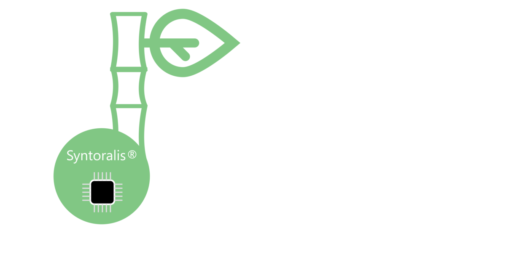
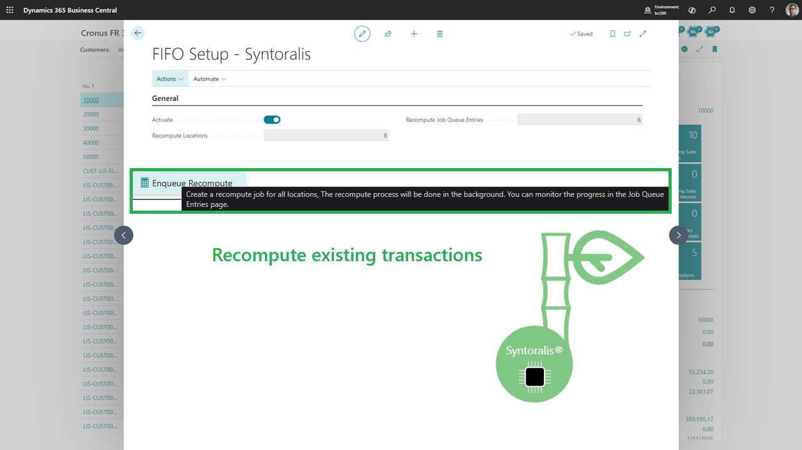
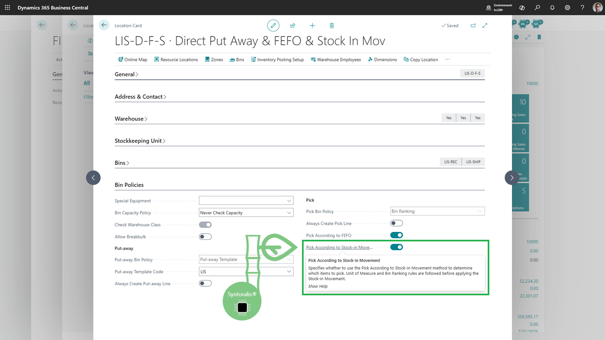
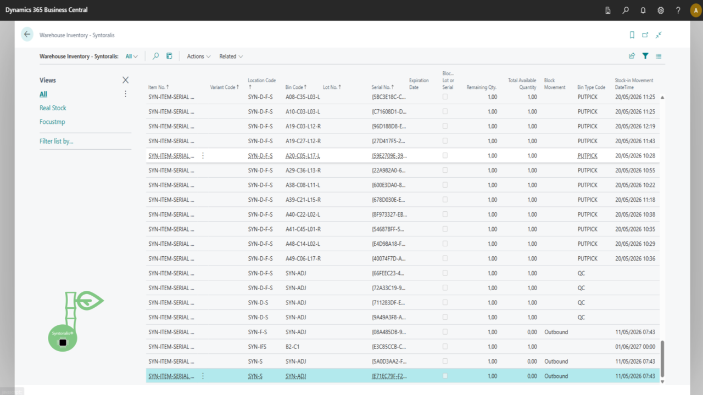
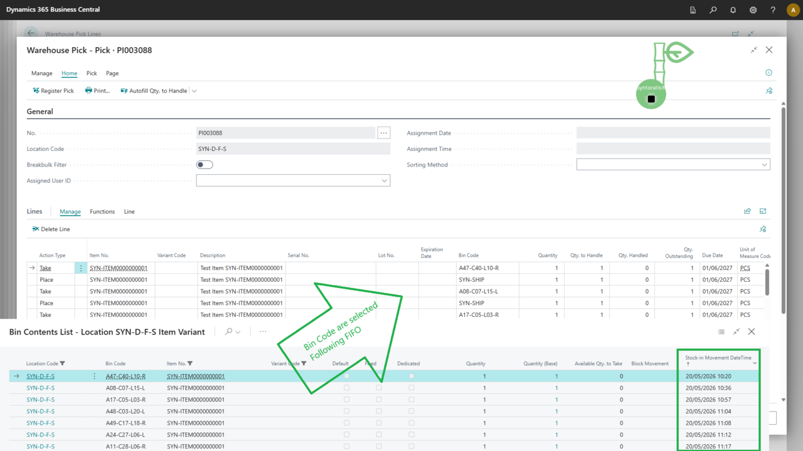

#  Syntoralis FIFO Logistic
 
<table>
<tbody>
<tr><td><strong>Produit</strong></td><td>Syntoralis FIFO Logistic</td></tr>
<tr><td><strong>Éditeur</strong></td><td>Syntoralis EURL</td></tr>
<tr><td><strong>Version</strong></td><td>1.0.0.57</td></tr>
<tr><td><strong>Plateforme</strong></td><td>Microsoft Dynamics 365 Business Central 27.0+ (Cloud)</td></tr>
<tr><td><strong>Date de la fiche</strong></td><td>29/10/2026</td></tr>
<tr><td><strong>Licence</strong></td><td>Propriétaire</td></tr>
<tr><td><strong>Documentation</strong></td><td><a href="https://syntoralis.github.io/BCApps/syntoralis-fifo-logistic/">Documentation en ligne</a></td></tr>
<tr><td><strong>Marketplace</strong></td><td><a href="https://marketplace.microsoft.com/en-us/product/PUBID.syntoraliseurl1775292660785%7CAID.syntoralis-fifo-logistic%7CPAPPID.11dc3515-69b5-4008-b250-fb7b76a7f281">Page produit sur le Microsoft Marketplace</a></td></tr>
</tbody>
</table>

<strong>Promesse :</strong> Prélevez le stock le plus ancien, automatiquement, sur tous vos processus d'entrepôt. Réduisez le vieillissement des stocks, éliminez les erreurs d'allocation et restez conforme en toute circonstance - sans changer vos processus Business Central.

### Table des matières

<a href="#sec1"><svg viewBox="0 0 20 20" width="36" height="36" style="vertical-align:-6px" xmlns="http://www.w3.org/2000/svg"><path d="M4 2h9l4 4v12a1 1 0 0 1-1 1H4a1 1 0 0 1-1-1V3a1 1 0 0 1 1-1z" fill="none" stroke="#1B5E20" stroke-width="1.4"/><path d="M13 2v4h4" fill="none" stroke="#1B5E20" stroke-width="1.4"/><line x1="6" y1="9" x2="15" y2="9" stroke="#1B5E20" stroke-width="1.1"/><line x1="6" y1="12" x2="15" y2="12" stroke="#1B5E20" stroke-width="1.1"/><line x1="6" y1="15" x2="12" y2="15" stroke="#1B5E20" stroke-width="1.1"/></svg> Présentation générale</a>
<a href="#sec2"><svg viewBox="0 0 20 20" width="36" height="36" style="vertical-align:-6px" xmlns="http://www.w3.org/2000/svg"><circle cx="10" cy="10" r="8" fill="none" stroke="#1B5E20" stroke-width="1.6"/><path d="M6 10.5l3 3 5.5-6.5" stroke="#1B5E20" stroke-width="2" fill="none" stroke-linecap="round" stroke-linejoin="round"/></svg> Qu'est-ce que le FIFO physique résout ?</a>
<a href="#sec3"><svg viewBox="0 0 24 24" width="36" height="36" style="vertical-align:-6px" xmlns="http://www.w3.org/2000/svg"><path d="M9.401 3.003c1.118-1.36 3.081-1.36 4.199 0l.399.487c.316.385.803.59 1.296.546l.627-.055c1.74-.153 3.204 1.31 3.05 3.05l-.055.627a1.63 1.63 0 0 0 .546 1.296l.487.399c1.36 1.118 1.36 3.081 0 4.199l-.487.399a1.63 1.63 0 0 0-.546 1.296l.055.627c.153 1.74-1.31 3.204-3.05 3.05l-.627-.055a1.63 1.63 0 0 0-1.296.546l-.399.487c-1.118 1.36-3.081 1.36-4.199 0l-.399-.487a1.63 1.63 0 0 0-1.296-.546l-.627.055c-1.74.153-3.204-1.31-3.05-3.05l.055-.627a1.63 1.63 0 0 0-.546-1.296l-.487-.399c-1.36-1.118-1.36-3.081 0-4.199l.487-.399a1.63 1.63 0 0 0 .546-1.296l-.055-.627c-.153-1.74 1.31-3.204 3.05-3.05l.627.055a1.63 1.63 0 0 0 1.296-.546l.399-.487z" fill="none" stroke="#1B5E20" stroke-width="1.4"/><circle cx="12" cy="12" r="3" fill="none" stroke="#1B5E20" stroke-width="1.4"/></svg> La solution : FIFO physique automatisé</a>
<a href="#sec4"><svg viewBox="0 0 20 20" width="36" height="36" style="vertical-align:-6px" xmlns="http://www.w3.org/2000/svg"><polygon points="10,2 12.4,7.5 18.5,8 14,12 15.3,18 10,15 4.7,18 6,12 1.5,8 7.6,7.5" fill="#1B5E20"/></svg> Bénéfices clés</a>
<a href="#sec5"><svg viewBox="0 0 20 20" width="36" height="36" style="vertical-align:-6px" xmlns="http://www.w3.org/2000/svg"><circle cx="7" cy="6" r="2.6" fill="#1B5E20"/><path d="M2 17c0-3 2.2-5 5-5s5 2 5 5" fill="#1B5E20"/><circle cx="15" cy="7" r="2" fill="#1B5E20"/></svg> Pour qui ?</a>
<a href="#sec6"><svg viewBox="0 0 20 20" width="36" height="36" style="vertical-align:-6px" xmlns="http://www.w3.org/2000/svg"><rect x="3" y="3" width="14" height="14" rx="2" fill="none" stroke="#1B5E20" stroke-width="1.4"/><path d="M6 7l1.5 1.5L10 6" stroke="#1B5E20" stroke-width="1.4" fill="none" stroke-linecap="round" stroke-linejoin="round"/><line x1="11" y1="7.5" x2="14" y2="7.5" stroke="#1B5E20" stroke-width="1.2"/><path d="M6 11l1.5 1.5L10 10" stroke="#1B5E20" stroke-width="1.4" fill="none" stroke-linecap="round" stroke-linejoin="round"/><line x1="11" y1="11.5" x2="14" y2="11.5" stroke="#1B5E20" stroke-width="1.2"/></svg> Fonctionnalités phares</a>
<a href="#sec7"><svg viewBox="0 0 20 20" width="36" height="36" style="vertical-align:-6px" xmlns="http://www.w3.org/2000/svg"><path d="M15 5A6 6 0 1 0 13 14" stroke="#1B5E20" stroke-width="1.6" fill="none" stroke-linecap="round"/><polygon points="15,2 18,5 14,5" fill="#1B5E20"/></svg> Cas d'usage typique</a>
<a href="#sec8"><svg viewBox="0 0 20 20" width="36" height="36" style="vertical-align:-6px" xmlns="http://www.w3.org/2000/svg"><path d="M10 3v5" stroke="#1B5E20" stroke-width="2" stroke-linecap="round"/><path d="M6.2 5.5a6 6 0 1 0 7.6 0" fill="none" stroke="#1B5E20" stroke-width="1.6" stroke-linecap="round"/></svg> Mise en service rapide sans interruption de votre activité</a>
<a href="#sec9"><svg viewBox="0 0 20 20" width="36" height="36" style="vertical-align:-6px" xmlns="http://www.w3.org/2000/svg"><rect x="3" y="6" width="14" height="10" rx="2" fill="none" stroke="#1B5E20" stroke-width="1.4"/><path d="M7 6l1-2h4l1 2" fill="none" stroke="#1B5E20" stroke-width="1.4" stroke-linejoin="round"/><circle cx="10" cy="11" r="2.6" fill="none" stroke="#1B5E20" stroke-width="1.4"/></svg> Captures d'écran</a>
<a href="#sec10"><svg viewBox="0 0 20 20" width="36" height="36" style="vertical-align:-6px" xmlns="http://www.w3.org/2000/svg"><circle cx="10" cy="10" r="7.5" fill="none" stroke="#1B5E20" stroke-width="1.4"/><ellipse cx="10" cy="10" rx="3.5" ry="7.5" fill="none" stroke="#1B5E20" stroke-width="1.2"/><line x1="2.5" y1="10" x2="17.5" y2="10" stroke="#1B5E20" stroke-width="1.2"/></svg> Compatibilité & prérequis</a>
<a href="#sec11"><svg viewBox="0 0 20 20" width="36" height="36" style="vertical-align:-6px" xmlns="http://www.w3.org/2000/svg"><circle cx="10" cy="10" r="7.5" fill="none" stroke="#1B5E20" stroke-width="1.4"/><text x="10" y="14" text-anchor="middle" font-size="12" font-weight="bold" fill="#1B5E20">$</text></svg> Tarification & essai</a>
<a href="#sec12"><svg viewBox="0 0 20 20" width="36" height="36" style="vertical-align:-6px" xmlns="http://www.w3.org/2000/svg"><circle cx="10" cy="10" r="8" fill="none" stroke="#1B5E20" stroke-width="1.6"/><text x="10" y="15" text-anchor="middle" font-size="15" font-weight="bold" fill="#1B5E20">?</text></svg> FAQ</a>
<a href="#sec13"><svg viewBox="0 0 20 20" width="36" height="36" style="vertical-align:-6px" xmlns="http://www.w3.org/2000/svg"><path d="M10 2l7 3v5c0 4-3 7-7 8-4-1-7-4-7-8V5l7-3z" fill="none" stroke="#1B5E20" stroke-width="1.5" stroke-linejoin="round"/><path d="M6.5 10l2.5 2.5 4.5-5" stroke="#1B5E20" stroke-width="1.6" fill="none" stroke-linecap="round" stroke-linejoin="round"/></svg> Sécurité & conformité</a>

### <svg viewBox="0 0 20 20" width="36" height="36" style="vertical-align:-6px" xmlns="http://www.w3.org/2000/svg"><path d="M4 2h9l4 4v12a1 1 0 0 1-1 1H4a1 1 0 0 1-1-1V3a1 1 0 0 1 1-1z" fill="none" stroke="#1B5E20" stroke-width="1.4"/><path d="M13 2v4h4" fill="none" stroke="#1B5E20" stroke-width="1.4"/><line x1="6" y1="9" x2="15" y2="9" stroke="#1B5E20" stroke-width="1.1"/><line x1="6" y1="12" x2="15" y2="12" stroke="#1B5E20" stroke-width="1.1"/><line x1="6" y1="15" x2="12" y2="15" stroke="#1B5E20" stroke-width="1.1"/></svg> Présentation générale

Syntoralis FIFO Logistic est une extension **Microsoft Dynamics 365 Business Central** qui garantit une rotation **FIFO physique réelle** : vos prélèvements consomment le stock le plus ancien disponible, selon la date et l'heure réelles d'entrée en stock (*dernier mouvement d'entrée en stock*), **quelle que soit la position du stock dans l'entrepôt**.

Là où le FIFO standard de Business Central est avant tout une méthode de *valorisation comptable*, Syntoralis FIFO Logistic agit au niveau de l'**exécution physique** : vos opérateurs préparent toujours le bon stock, au bon moment.

**En résumé :** le bon stock, au bon moment - à chaque prélèvement.

### <svg viewBox="0 0 20 20" width="36" height="36" style="vertical-align:-6px" xmlns="http://www.w3.org/2000/svg"><circle cx="10" cy="10" r="8" fill="none" stroke="#1B5E20" stroke-width="1.6"/><path d="M6 10.5l3 3 5.5-6.5" stroke="#1B5E20" stroke-width="2" fill="none" stroke-linecap="round" stroke-linejoin="round"/></svg> Qu'est-ce que le FIFO physique résout ?

Dans de nombreux entrepôts Business Central, le FIFO est géré par la comptabilité… mais pas par la préparation physique :

<svg viewBox="0 0 20 20" width="36" height="36" style="vertical-align:-6px" xmlns="http://www.w3.org/2000/svg"><circle cx="10" cy="10" r="8" fill="none" stroke="#1B5E20" stroke-width="1.6"/><path d="M6 10.5l3 3 5.5-6.5" stroke="#1B5E20" stroke-width="2" fill="none" stroke-linecap="round" stroke-linejoin="round"/></svg> Le stock le plus récent est souvent prélevé en premier (proximité, facilité d'accès). 
<svg viewBox="0 0 20 20" width="36" height="36" style="vertical-align:-6px" xmlns="http://www.w3.org/2000/svg"><circle cx="10" cy="10" r="8" fill="none" stroke="#1B5E20" stroke-width="1.6"/><path d="M6 10.5l3 3 5.5-6.5" stroke="#1B5E20" stroke-width="2" fill="none" stroke-linecap="round" stroke-linejoin="round"/></svg> Les stocks anciens restent en fond de bac, vieillissent et deviennent obsolètes. 
<svg viewBox="0 0 20 20" width="36" height="36" style="vertical-align:-6px" xmlns="http://www.w3.org/2000/svg"><circle cx="10" cy="10" r="8" fill="none" stroke="#1B5E20" stroke-width="1.6"/><path d="M6 10.5l3 3 5.5-6.5" stroke="#1B5E20" stroke-width="2" fill="none" stroke-linecap="round" stroke-linejoin="round"/></svg> Les pertes et dépréciations augmentent sans visibilité. 
<svg viewBox="0 0 20 20" width="36" height="36" style="vertical-align:-6px" xmlns="http://www.w3.org/2000/svg"><circle cx="10" cy="10" r="8" fill="none" stroke="#1B5E20" stroke-width="1.6"/><path d="M6 10.5l3 3 5.5-6.5" stroke="#1B5E20" stroke-width="2" fill="none" stroke-linecap="round" stroke-linejoin="round"/></svg> Les audits et traçabilités sont difficiles à justifier. 
<svg viewBox="0 0 20 20" width="36" height="36" style="vertical-align:-6px" xmlns="http://www.w3.org/2000/svg"><circle cx="10" cy="10" r="8" fill="none" stroke="#1B5E20" stroke-width="1.6"/><path d="M6 10.5l3 3 5.5-6.5" stroke="#1B5E20" stroke-width="2" fill="none" stroke-linecap="round" stroke-linejoin="round"/></svg> Les articles suivis par lot ou numéro de série compliquent la rotation. 

**Résultat :** gaspillage, coûts cachés, risques de non-conformité et perte de marge.

### <svg viewBox="0 0 24 24" width="36" height="36" style="vertical-align:-6px" xmlns="http://www.w3.org/2000/svg"><path d="M9.401 3.003c1.118-1.36 3.081-1.36 4.199 0l.399.487c.316.385.803.59 1.296.546l.627-.055c1.74-.153 3.204 1.31 3.05 3.05l-.055.627a1.63 1.63 0 0 0 .546 1.296l.487.399c1.36 1.118 1.36 3.081 0 4.199l-.487.399a1.63 1.63 0 0 0-.546 1.296l.055.627c.153 1.74-1.31 3.204-3.05 3.05l-.627-.055a1.63 1.63 0 0 0-1.296.546l-.399.487c-1.118 1.36-3.081 1.36-4.199 0l-.399-.487a1.63 1.63 0 0 0-1.296-.546l-.627.055c-1.74.153-3.204-1.31-3.05-3.05l.055-.627a1.63 1.63 0 0 0-.546-1.296l-.487-.399c-1.36-1.118-1.36-3.081 0-4.199l.487-.399a1.63 1.63 0 0 0 .546-1.296l-.055-.627c-.153-1.74 1.31-3.204 3.05-3.05l.627.055a1.63 1.63 0 0 0 1.296-.546l.399-.487z" fill="none" stroke="#1B5E20" stroke-width="1.4"/><circle cx="12" cy="12" r="3" fill="none" stroke="#1B5E20" stroke-width="1.4"/></svg> La solution : FIFO physique automatisé

Syntoralis FIFO Logistic prend le contrôle de la sélection des stocks lors de la création des prélèvements :

<svg viewBox="0 0 24 24" width="36" height="36" style="vertical-align:-6px" xmlns="http://www.w3.org/2000/svg"><path d="M9.401 3.003c1.118-1.36 3.081-1.36 4.199 0l.399.487c.316.385.803.59 1.296.546l.627-.055c1.74-.153 3.204 1.31 3.05 3.05l-.055.627a1.63 1.63 0 0 0 .546 1.296l.487.399c1.36 1.118 1.36 3.081 0 4.199l-.487.399a1.63 1.63 0 0 0-.546 1.296l.055.627c.153 1.74-1.31 3.204-3.05 3.05l-.627-.055a1.63 1.63 0 0 0-1.296.546l-.399.487c-1.118 1.36-3.081 1.36-4.199 0l-.399-.487a1.63 1.63 0 0 0-1.296-.546l-.627.055c-1.74.153-3.204-1.31-3.05-3.05l.055-.627a1.63 1.63 0 0 0-.546-1.296l-.487-.399c-1.36-1.118-1.36-3.081 0-4.199l.487-.399a1.63 1.63 0 0 0 .546-1.296l-.055-.627c-.153-1.74 1.31-3.204 3.05-3.05l.627.055a1.63 1.63 0 0 0 1.296-.546l.399-.487z" fill="none" stroke="#1B5E20" stroke-width="1.4"/><circle cx="12" cy="12" r="3" fill="none" stroke="#1B5E20" stroke-width="1.4"/></svg> Sélectionne automatiquement le stock le plus ancien selon le **dernier mouvement d'entrée en stock**. 
<svg viewBox="0 0 24 24" width="36" height="36" style="vertical-align:-6px" xmlns="http://www.w3.org/2000/svg"><path d="M9.401 3.003c1.118-1.36 3.081-1.36 4.199 0l.399.487c.316.385.803.59 1.296.546l.627-.055c1.74-.153 3.204 1.31 3.05 3.05l-.055.627a1.63 1.63 0 0 0 .546 1.296l.487.399c1.36 1.118 1.36 3.081 0 4.199l-.487.399a1.63 1.63 0 0 0-.546 1.296l.055.627c.153 1.74-1.31 3.204-3.05 3.05l-.627-.055a1.63 1.63 0 0 0-1.296.546l-.399.487c-1.118 1.36-3.081 1.36-4.199 0l-.399-.487a1.63 1.63 0 0 0-1.296-.546l-.627.055c-1.74.153-3.204-1.31-3.05-3.05l.055-.627a1.63 1.63 0 0 0-.546-1.296l-.487-.399c-1.36-1.118-1.36-3.081 0-4.199l.487-.399a1.63 1.63 0 0 0 .546-1.296l-.055-.627c-.153-1.74 1.31-3.204 3.05-3.05l.627.055a1.63 1.63 0 0 0 1.296-.546l.399-.487z" fill="none" stroke="#1B5E20" stroke-width="1.4"/><circle cx="12" cy="12" r="3" fill="none" stroke="#1B5E20" stroke-width="1.4"/></svg> Fonctionne sur tous les processus de sortie de stock (prélèvements entrepôt, inventaire, mouvements manuels, réapprovisionnements). 
<svg viewBox="0 0 24 24" width="36" height="36" style="vertical-align:-6px" xmlns="http://www.w3.org/2000/svg"><path d="M9.401 3.003c1.118-1.36 3.081-1.36 4.199 0l.399.487c.316.385.803.59 1.296.546l.627-.055c1.74-.153 3.204 1.31 3.05 3.05l-.055.627a1.63 1.63 0 0 0 .546 1.296l.487.399c1.36 1.118 1.36 3.081 0 4.199l-.487.399a1.63 1.63 0 0 0-.546 1.296l.055.627c.153 1.74-1.31 3.204-3.05 3.05l-.627-.055a1.63 1.63 0 0 0-1.296.546l-.399.487c-1.118 1.36-3.081 1.36-4.199 0l-.399-.487a1.63 1.63 0 0 0-1.296-.546l-.627.055c-1.74.153-3.204-1.31-3.05-3.05l.055-.627a1.63 1.63 0 0 0-.546-1.296l-.487-.399c-1.36-1.118-1.36-3.081 0-4.199l.487-.399a1.63 1.63 0 0 0 .546-1.296l-.055-.627c-.153-1.74 1.31-3.204 3.05-3.05l.627.055a1.63 1.63 0 0 0 1.296-.546l.399-.487z" fill="none" stroke="#1B5E20" stroke-width="1.4"/><circle cx="12" cy="12" r="3" fill="none" stroke="#1B5E20" stroke-width="1.4"/></svg> Gère les articles suivis par lot, par numéro de série et les dates d'expiration (FEFO). 
<svg viewBox="0 0 24 24" width="36" height="36" style="vertical-align:-6px" xmlns="http://www.w3.org/2000/svg"><path d="M9.401 3.003c1.118-1.36 3.081-1.36 4.199 0l.399.487c.316.385.803.59 1.296.546l.627-.055c1.74-.153 3.204 1.31 3.05 3.05l-.055.627a1.63 1.63 0 0 0 .546 1.296l.487.399c1.36 1.118 1.36 3.081 0 4.199l-.487.399a1.63 1.63 0 0 0-.546 1.296l.055.627c.153 1.74-1.31 3.204-3.05 3.05l-.627-.055a1.63 1.63 0 0 0-1.296.546l-.399.487c-1.118 1.36-3.081 1.36-4.199 0l-.399-.487a1.63 1.63 0 0 0-1.296-.546l-.627.055c-1.74.153-3.204-1.31-3.05-3.05l.055-.627a1.63 1.63 0 0 0-.546-1.296l-.487-.399c-1.36-1.118-1.36-3.081 0-4.199l.487-.399a1.63 1.63 0 0 0 .546-1.296l-.055-.627c-.153-1.74 1.31-3.204 3.05-3.05l.627.055a1.63 1.63 0 0 0 1.296-.546l.399-.487z" fill="none" stroke="#1B5E20" stroke-width="1.4"/><circle cx="12" cy="12" r="3" fill="none" stroke="#1B5E20" stroke-width="1.4"/></svg> Fractionne automatiquement les lignes sur plusieurs couches FIFO si nécessaire. 
<svg viewBox="0 0 24 24" width="36" height="36" style="vertical-align:-6px" xmlns="http://www.w3.org/2000/svg"><path d="M9.401 3.003c1.118-1.36 3.081-1.36 4.199 0l.399.487c.316.385.803.59 1.296.546l.627-.055c1.74-.153 3.204 1.31 3.05 3.05l-.055.627a1.63 1.63 0 0 0 .546 1.296l.487.399c1.36 1.118 1.36 3.081 0 4.199l-.487.399a1.63 1.63 0 0 0-.546 1.296l.055.627c.153 1.74-1.31 3.204-3.05 3.05l-.627-.055a1.63 1.63 0 0 0-1.296.546l-.399.487c-1.118 1.36-3.081 1.36-4.199 0l-.399-.487a1.63 1.63 0 0 0-1.296-.546l-.627.055c-1.74.153-3.204-1.31-3.05-3.05l.055-.627a1.63 1.63 0 0 0-.546-1.296l-.487-.399c-1.36-1.118-1.36-3.081 0-4.199l.487-.399a1.63 1.63 0 0 0 .546-1.296l-.055-.627c-.153-1.74 1.31-3.204 3.05-3.05l.627.055a1.63 1.63 0 0 0 1.296-.546l.399-.487z" fill="none" stroke="#1B5E20" stroke-width="1.4"/><circle cx="12" cy="12" r="3" fill="none" stroke="#1B5E20" stroke-width="1.4"/></svg> Offre une visibilité complète via la page **Inventaire d'entrepôt**. 
<svg viewBox="0 0 24 24" width="36" height="36" style="vertical-align:-6px" xmlns="http://www.w3.org/2000/svg"><path d="M9.401 3.003c1.118-1.36 3.081-1.36 4.199 0l.399.487c.316.385.803.59 1.296.546l.627-.055c1.74-.153 3.204 1.31 3.05 3.05l-.055.627a1.63 1.63 0 0 0 .546 1.296l.487.399c1.36 1.118 1.36 3.081 0 4.199l-.487.399a1.63 1.63 0 0 0-.546 1.296l.055.627c.153 1.74-1.31 3.204-3.05 3.05l-.627-.055a1.63 1.63 0 0 0-1.296.546l-.399.487c-1.118 1.36-3.081 1.36-4.199 0l-.399-.487a1.63 1.63 0 0 0-1.296-.546l-.627.055c-1.74.153-3.204-1.31-3.05-3.05l.055-.627a1.63 1.63 0 0 0-.546-1.296l-.487-.399c-1.36-1.118-1.36-3.081 0-4.199l.487-.399a1.63 1.63 0 0 0 .546-1.296l-.055-.627c-.153-1.74 1.31-3.204 3.05-3.05l.627.055a1.63 1.63 0 0 0 1.296-.546l.399-.487z" fill="none" stroke="#1B5E20" stroke-width="1.4"/><circle cx="12" cy="12" r="3" fill="none" stroke="#1B5E20" stroke-width="1.4"/></svg> S'intègre sans modifier vos processus standards Business Central. 

### <svg viewBox="0 0 20 20" width="36" height="36" style="vertical-align:-6px" xmlns="http://www.w3.org/2000/svg"><polygon points="10,2 12.4,7.5 18.5,8 14,12 15.3,18 10,15 4.7,18 6,12 1.5,8 7.6,7.5" fill="#1B5E20"/></svg> Bénéfices clés

| Bénéfice | Ce que vous gagnez |
|---|---|
| **<svg viewBox="0 0 20 20" width="36" height="36" style="vertical-align:-6px" xmlns="http://www.w3.org/2000/svg"><circle cx="10" cy="10" r="7.5" fill="none" stroke="#1B5E20" stroke-width="1.4"/><circle cx="10" cy="10" r="4.5" fill="none" stroke="#1B5E20" stroke-width="1.2"/><circle cx="10" cy="10" r="1.6" fill="#1B5E20"/></svg> Précision** | Toujours le bon stock prélevé - zéro erreur d'allocation |
| **<svg viewBox="0 0 20 20" width="36" height="36" style="vertical-align:-6px" xmlns="http://www.w3.org/2000/svg"><path d="M4 16c0-6 4-12 13-12-1 7-5 12-13 12z" fill="none" stroke="#1B5E20" stroke-width="1.4" stroke-linejoin="round"/><path d="M4 16c3-3 7-6 11-9" stroke="#1B5E20" stroke-width="1.2" fill="none"/></svg> Aucun gaspillage** | Les stocks anciens sortent en premier - moins d'obsolescence |
| **<svg viewBox="0 0 20 20" width="36" height="36" style="vertical-align:-6px" xmlns="http://www.w3.org/2000/svg"><rect x="4" y="5" width="12" height="13" rx="1.5" fill="none" stroke="#1B5E20" stroke-width="1.4"/><path d="M7 5V3.5a1.5 1.5 0 0 1 3 0V5" fill="none" stroke="#1B5E20" stroke-width="1.4"/><path d="M7 10l2 2 4-4" stroke="#1B5E20" stroke-width="1.4" fill="none" stroke-linecap="round" stroke-linejoin="round"/></svg> Audit-ready** | Visibilité complète des couches FIFO, dates d'entrée, quantités restantes |
| **<svg viewBox="0 0 20 20" width="36" height="36" style="vertical-align:-6px" xmlns="http://www.w3.org/2000/svg"><polygon points="11,2 6,11 9,11 8,18 14,9 11,9" fill="#1B5E20"/></svg> Rapidité** | Prélèvements plus rapides, moins de recherches manuelles |
| **<svg viewBox="0 0 20 20" width="36" height="36" style="vertical-align:-6px" xmlns="http://www.w3.org/2000/svg"><path d="M3 17V9M8 17V6M13 17V3M17 17V11" stroke="#1B5E20" stroke-width="2.2" stroke-linecap="round"/></svg> ROI rapide** | Réduction des pertes et des coûts de stockage |

> Compatibilité lots / numéros de série / FEFO et non-intrusivité : voir [§3](#sec3) et [§6](#sec6).

### <svg viewBox="0 0 20 20" width="36" height="36" style="vertical-align:-6px" xmlns="http://www.w3.org/2000/svg"><circle cx="7" cy="6" r="2.6" fill="#1B5E20"/><path d="M2 17c0-3 2.2-5 5-5s5 2 5 5" fill="#1B5E20"/><circle cx="15" cy="7" r="2" fill="#1B5E20"/></svg> Pour qui ?

<svg viewBox="0 0 20 20" width="36" height="36" style="vertical-align:-6px" xmlns="http://www.w3.org/2000/svg"><circle cx="7" cy="6" r="2.2" fill="#1B5E20"/><circle cx="13" cy="6" r="2.2" fill="#1B5E20"/><circle cx="10" cy="12" r="2.2" fill="#1B5E20"/><path d="M3 18c0-2.2 1.8-4 4-4s4 1.8 4 4M9 18c0-2.2 1.8-4 4-4s4 1.8 4 4" fill="none" stroke="#1B5E20" stroke-width="1.4" stroke-linecap="round"/></svg> **Fabricants discrets, procédés et sur projets** avec gestion d'entrepôt. 
<svg viewBox="0 0 20 20" width="36" height="36" style="vertical-align:-6px" xmlns="http://www.w3.org/2000/svg"><circle cx="7" cy="6" r="2.2" fill="#1B5E20"/><circle cx="13" cy="6" r="2.2" fill="#1B5E20"/><circle cx="10" cy="12" r="2.2" fill="#1B5E20"/><path d="M3 18c0-2.2 1.8-4 4-4s4 1.8 4 4M9 18c0-2.2 1.8-4 4-4s4 1.8 4 4" fill="none" stroke="#1B5E20" stroke-width="1.4" stroke-linecap="round"/></svg> **Entrepôts multi-emplacement** souhaitant une rotation FIFO stricte même sans traçabilité complète. 
<svg viewBox="0 0 20 20" width="36" height="36" style="vertical-align:-6px" xmlns="http://www.w3.org/2000/svg"><circle cx="7" cy="6" r="2.2" fill="#1B5E20"/><circle cx="13" cy="6" r="2.2" fill="#1B5E20"/><circle cx="10" cy="12" r="2.2" fill="#1B5E20"/><path d="M3 18c0-2.2 1.8-4 4-4s4 1.8 4 4M9 18c0-2.2 1.8-4 4-4s4 1.8 4 4" fill="none" stroke="#1B5E20" stroke-width="1.4" stroke-linecap="round"/></svg> **Entreprises avec articles périssables ou à durée de vie limitée.** 
<svg viewBox="0 0 20 20" width="36" height="36" style="vertical-align:-6px" xmlns="http://www.w3.org/2000/svg"><circle cx="7" cy="6" r="2.2" fill="#1B5E20"/><circle cx="13" cy="6" r="2.2" fill="#1B5E20"/><circle cx="10" cy="12" r="2.2" fill="#1B5E20"/><path d="M3 18c0-2.2 1.8-4 4-4s4 1.8 4 4M9 18c0-2.2 1.8-4 4-4s4 1.8 4 4" fill="none" stroke="#1B5E20" stroke-width="1.4" stroke-linecap="round"/></svg> **Organisations soumises à des audits** (traçabilité, FIFO, FEFO). 
<svg viewBox="0 0 20 20" width="36" height="36" style="vertical-align:-6px" xmlns="http://www.w3.org/2000/svg"><circle cx="7" cy="6" r="2.2" fill="#1B5E20"/><circle cx="13" cy="6" r="2.2" fill="#1B5E20"/><circle cx="10" cy="12" r="2.2" fill="#1B5E20"/><path d="M3 18c0-2.2 1.8-4 4-4s4 1.8 4 4M9 18c0-2.2 1.8-4 4-4s4 1.8 4 4" fill="none" stroke="#1B5E20" stroke-width="1.4" stroke-linecap="round"/></svg> **Équipes logistique** cherchant à réduire le gaspillage et les erreurs. 

### <svg viewBox="0 0 20 20" width="36" height="36" style="vertical-align:-6px" xmlns="http://www.w3.org/2000/svg"><rect x="3" y="3" width="14" height="14" rx="2" fill="none" stroke="#1B5E20" stroke-width="1.4"/><path d="M6 7l1.5 1.5L10 6" stroke="#1B5E20" stroke-width="1.4" fill="none" stroke-linecap="round" stroke-linejoin="round"/><line x1="11" y1="7.5" x2="14" y2="7.5" stroke="#1B5E20" stroke-width="1.2"/><path d="M6 11l1.5 1.5L10 10" stroke="#1B5E20" stroke-width="1.4" fill="none" stroke-linecap="round" stroke-linejoin="round"/><line x1="11" y1="11.5" x2="14" y2="11.5" stroke="#1B5E20" stroke-width="1.2"/></svg> Fonctionnalités phares

| Fonctionnalité | Bénéfice client |
|---|---|
| **<svg viewBox="0 0 24 24" width="36" height="36" style="vertical-align:-6px" xmlns="http://www.w3.org/2000/svg"><path d="M9.401 3.003c1.118-1.36 3.081-1.36 4.199 0l.399.487c.316.385.803.59 1.296.546l.627-.055c1.74-.153 3.204 1.31 3.05 3.05l-.055.627a1.63 1.63 0 0 0 .546 1.296l.487.399c1.36 1.118 1.36 3.081 0 4.199l-.487.399a1.63 1.63 0 0 0-.546 1.296l.055.627c.153 1.74-1.31 3.204-3.05 3.05l-.627-.055a1.63 1.63 0 0 0-1.296.546l-.399.487c-1.118 1.36-3.081 1.36-4.199 0l-.399-.487a1.63 1.63 0 0 0-1.296-.546l-.627.055c-1.74.153-3.204-1.31-3.05-3.05l.055-.627a1.63 1.63 0 0 0-.546-1.296l-.487-.399c-1.36-1.118-1.36-3.081 0-4.199l.487-.399a1.63 1.63 0 0 0 .546-1.296l-.055-.627c-.153-1.74 1.31-3.204 3.05-3.05l.627.055a1.63 1.63 0 0 0 1.296-.546l.399-.487z" fill="none" stroke="#1B5E20" stroke-width="1.4"/><circle cx="12" cy="12" r="3" fill="none" stroke="#1B5E20" stroke-width="1.4"/></svg> Moteur de prélèvement FIFO** | Sélection automatique du stock le plus ancien sur tous vos processus |
| **<svg viewBox="0 0 20 20" width="36" height="36" style="vertical-align:-6px" xmlns="http://www.w3.org/2000/svg"><path d="M10 3l7 3.5-7 3.5-7-3.5z" fill="none" stroke="#1B5E20" stroke-width="1.3" stroke-linejoin="round"/><path d="M3 10l7 3.5 7-3.5" fill="none" stroke="#1B5E20" stroke-width="1.3" stroke-linejoin="round"/><path d="M3 13.5l7 3.5 7-3.5" fill="none" stroke="#1B5E20" stroke-width="1.3" stroke-linejoin="round"/></svg> Articles suivis par lot** | Rotation FIFO des lots selon leur entrée en stock (voir [§3](#sec3)) |
| **<svg viewBox="0 0 20 20" width="36" height="36" style="vertical-align:-6px" xmlns="http://www.w3.org/2000/svg"><rect x="3" y="4" width="14" height="12" rx="1" fill="none" stroke="#1B5E20" stroke-width="1.3"/><line x1="6" y1="6" x2="6" y2="14" stroke="#1B5E20" stroke-width="1.6"/><line x1="8" y1="6" x2="8" y2="14" stroke="#1B5E20" stroke-width="1"/><line x1="10" y1="6" x2="10" y2="14" stroke="#1B5E20" stroke-width="2"/><line x1="12" y1="6" x2="12" y2="14" stroke="#1B5E20" stroke-width="1"/><line x1="14" y1="6" x2="14" y2="14" stroke="#1B5E20" stroke-width="1.4"/></svg> Articles en séries** | Sélection FIFO des numéros de série (voir [§3](#sec3)) |
| **<svg viewBox="0 0 20 20" width="36" height="36" style="vertical-align:-6px" xmlns="http://www.w3.org/2000/svg"><rect x="3" y="5" width="14" height="12" rx="1.5" fill="none" stroke="#1B5E20" stroke-width="1.4"/><line x1="3" y1="9" x2="17" y2="9" stroke="#1B5E20" stroke-width="1.2"/><line x1="7" y1="3" x2="7" y2="6" stroke="#1B5E20" stroke-width="1.4" stroke-linecap="round"/><line x1="13" y1="3" x2="13" y2="6" stroke="#1B5E20" stroke-width="1.4" stroke-linecap="round"/><circle cx="10" cy="13" r="1.2" fill="#1B5E20"/></svg> Compatibilité FEFO** | Gestion unifiée FIFO/FEFO pour les articles périssables (voir [§3](#sec3)) |
| **<svg viewBox="0 0 20 20" width="36" height="36" style="vertical-align:-6px" xmlns="http://www.w3.org/2000/svg"><path d="M4 4h5v5M4 4l12 12M16 4h-5v5" stroke="#1B5E20" stroke-width="1.4" fill="none" stroke-linecap="round" stroke-linejoin="round"/></svg> Fractionnement auto** | Répartition intelligente sur plusieurs couches FIFO (voir [§3](#sec3)) |
| **<svg viewBox="0 0 20 20" width="36" height="36" style="vertical-align:-6px" xmlns="http://www.w3.org/2000/svg"><path d="M2 9l8-6 8 6v8a1 1 0 0 1-1 1H3a1 1 0 0 1-1-1z" fill="none" stroke="#1B5E20" stroke-width="1.4" stroke-linejoin="round"/><rect x="8" y="13" width="4" height="5" fill="none" stroke="#1B5E20" stroke-width="1.2"/><line x1="2" y1="9" x2="18" y2="9" stroke="#1B5E20" stroke-width="1.2"/></svg> Page Inventaire d'entrepôt** | Visibilité opérationnelle des couches FIFO et de l'ordre de consommation (voir [§3](#sec3)) |
| **<svg viewBox="0 0 20 20" width="36" height="36" style="vertical-align:-6px" xmlns="http://www.w3.org/2000/svg"><path d="M15 5A6 6 0 1 0 13 14" stroke="#1B5E20" stroke-width="1.6" fill="none" stroke-linecap="round"/><polygon points="15,2 18,5 14,5" fill="#1B5E20"/></svg> Recalcul FIFO** | Initialisation sur environnements existants, en arrière-plan (voir [§8](#sec8)) |
| **<svg viewBox="0 0 20 20" width="36" height="36" style="vertical-align:-6px" xmlns="http://www.w3.org/2000/svg"><circle cx="10" cy="10" r="2.6" fill="none" stroke="#1B5E20" stroke-width="1.4"/><path d="M10 3v2M10 15v2M3 10h2M15 10h2M5 5l1.4 1.4M13.6 13.6l1.4 1.4M5 15l1.4-1.4M13.6 6.4l1.4-1.4" stroke="#1B5E20" stroke-width="1.3" stroke-linecap="round"/></svg> Paramétrage centralisé** | Activation globale puis par magasin, en toute sécurité (voir [§8](#sec8)) |
| **<svg viewBox="0 0 20 20" width="36" height="36" style="vertical-align:-6px" xmlns="http://www.w3.org/2000/svg"><circle cx="10" cy="10" r="7.5" fill="none" stroke="#1B5E20" stroke-width="1.4"/><path d="M2.5 10h15M10 2.5c2 2.5 2 12.5 0 15M10 2.5c-2 2.5-2 12.5 0 15" fill="none" stroke="#1B5E20" stroke-width="1.1"/></svg> Multilingue** | 14 langues disponibles (voir [§10](#sec10)) |

### <svg viewBox="0 0 20 20" width="36" height="36" style="vertical-align:-6px" xmlns="http://www.w3.org/2000/svg"><path d="M15 5A6 6 0 1 0 13 14" stroke="#1B5E20" stroke-width="1.6" fill="none" stroke-linecap="round"/><polygon points="15,2 18,5 14,5" fill="#1B5E20"/></svg> Cas d'usage typique

<svg viewBox="0 0 20 20" width="36" height="36" style="vertical-align:-6px" xmlns="http://www.w3.org/2000/svg"><path d="M10 3v9" stroke="#1B5E20" stroke-width="1.6" stroke-linecap="round"/><path d="M6 9l4 4 4-4" stroke="#1B5E20" stroke-width="1.6" fill="none" stroke-linecap="round" stroke-linejoin="round"/><path d="M4 16h12" stroke="#1B5E20" stroke-width="1.6" stroke-linecap="round"/></svg> **Réception** : le stock entre en entrepôt, la date/heure d'entrée (*dernier mouvement d'entrée en stock*) est enregistrée. 
<svg viewBox="0 0 20 20" width="36" height="36" style="vertical-align:-6px" xmlns="http://www.w3.org/2000/svg"><rect x="3" y="9" width="14" height="8" fill="none" stroke="#1B5E20" stroke-width="1.4" rx="1"/><path d="M3 9l2-4h10l2 4" fill="none" stroke="#1B5E20" stroke-width="1.4" stroke-linejoin="round"/><line x1="10" y1="9" x2="10" y2="17" stroke="#1B5E20" stroke-width="1.1"/></svg> **Stockage** : le stock est placé dans les emplacements selon votre organisation. 
<svg viewBox="0 0 20 20" width="36" height="36" style="vertical-align:-6px" xmlns="http://www.w3.org/2000/svg"><path d="M10 17V8" stroke="#1B5E20" stroke-width="1.6" stroke-linecap="round"/><path d="M6 11l4-4 4 4" stroke="#1B5E20" stroke-width="1.6" fill="none" stroke-linecap="round" stroke-linejoin="round"/><path d="M4 4h12" stroke="#1B5E20" stroke-width="1.6" stroke-linecap="round"/></svg> **Prélèvement** : lors de la création d'un prélèvement, le système sélectionne automatiquement le stock le plus ancien. 
<svg viewBox="0 0 20 20" width="36" height="36" style="vertical-align:-6px" xmlns="http://www.w3.org/2000/svg"><rect x="4" y="3" width="12" height="15" fill="none" stroke="#1B5E20" stroke-width="1.4" rx="1.5"/><line x1="7" y1="7" x2="13" y2="7" stroke="#1B5E20" stroke-width="1.1"/><line x1="7" y1="10" x2="13" y2="10" stroke="#1B5E20" stroke-width="1.1"/><path d="M7 13l2 2 4-4" stroke="#1B5E20" stroke-width="1.4" fill="none" stroke-linecap="round" stroke-linejoin="round"/></svg> **Préparation** : l'opérateur prépare le stock sélectionné - zéro erreur, zéro gaspillage. 
<svg viewBox="0 0 20 20" width="36" height="36" style="vertical-align:-6px" xmlns="http://www.w3.org/2000/svg"><circle cx="8.5" cy="8.5" r="5" fill="none" stroke="#1B5E20" stroke-width="1.5"/><line x1="12.5" y1="12.5" x2="17" y2="17" stroke="#1B5E20" stroke-width="1.8" stroke-linecap="round"/></svg> **Audit** : vérification de la séquence FIFO à tout moment (voir [§6](#sec6), page Inventaire d'entrepôt). 

### <svg viewBox="0 0 20 20" width="36" height="36" style="vertical-align:-6px" xmlns="http://www.w3.org/2000/svg"><path d="M10 3v5" stroke="#1B5E20" stroke-width="2" stroke-linecap="round"/><path d="M6.2 5.5a6 6 0 1 0 7.6 0" fill="none" stroke="#1B5E20" stroke-width="1.6" stroke-linecap="round"/></svg> Mise en service rapide sans interruption de votre activité

<svg viewBox="0 0 14 14" width="36" height="36" style="vertical-align:-6px" xmlns="http://www.w3.org/2000/svg"><path d="M11 5A5 5 0 1 0 9 11" stroke="#1B5E20" stroke-width="1.6" fill="none" stroke-linecap="round"/><polygon points="11,2 13,5 9,5" fill="#1B5E20"/></svg> **Recalcul FIFO** - initialise les couches FIFO à partir de votre historique d'entrepôt. 
<svg viewBox="0 0 14 14" width="36" height="36" style="vertical-align:-6px" xmlns="http://www.w3.org/2000/svg"><path d="M1 7h9M7 3l4 4-4 4" stroke="#1B5E20" stroke-width="1.8" fill="none" stroke-linecap="round" stroke-linejoin="round"/></svg> **Activation** - activez globalement puis par magasin. 
<svg viewBox="0 0 14 14" width="36" height="36" style="vertical-align:-6px" xmlns="http://www.w3.org/2000/svg"><rect x="1" y="1" width="12" height="12" fill="#1B5E20" rx="2"/></svg> **Exploitation** - vos prélèvements consomment automatiquement le stock le plus ancien. 

### <svg viewBox="0 0 20 20" width="36" height="36" style="vertical-align:-6px" xmlns="http://www.w3.org/2000/svg"><rect x="3" y="6" width="14" height="10" rx="2" fill="none" stroke="#1B5E20" stroke-width="1.4"/><path d="M7 6l1-2h4l1 2" fill="none" stroke="#1B5E20" stroke-width="1.4" stroke-linejoin="round"/><circle cx="10" cy="11" r="2.6" fill="none" stroke="#1B5E20" stroke-width="1.4"/></svg> Captures d'écran

*Paramétrage FIFO*

*Fiche emplacement*

*Page Inventaire d'entrepôt*

*Exemple de prélèvement entrepôt*

### <svg viewBox="0 0 20 20" width="36" height="36" style="vertical-align:-6px" xmlns="http://www.w3.org/2000/svg"><circle cx="10" cy="10" r="7.5" fill="none" stroke="#1B5E20" stroke-width="1.4"/><ellipse cx="10" cy="10" rx="3.5" ry="7.5" fill="none" stroke="#1B5E20" stroke-width="1.2"/><line x1="2.5" y1="10" x2="17.5" y2="10" stroke="#1B5E20" stroke-width="1.2"/></svg> Compatibilité & prérequis

<svg viewBox="0 0 20 20" width="36" height="36" style="vertical-align:-6px" xmlns="http://www.w3.org/2000/svg"><circle cx="10" cy="10" r="8" fill="none" stroke="#1B5E20" stroke-width="1.6"/><path d="M6 10.5l3 3 5.5-6.5" stroke="#1B5E20" stroke-width="2" fill="none" stroke-linecap="round" stroke-linejoin="round"/></svg> **Microsoft Dynamics 365 Business Central** version 27.0 ou supérieure (Cloud ou On-Premises). 
<svg viewBox="0 0 20 20" width="36" height="36" style="vertical-align:-6px" xmlns="http://www.w3.org/2000/svg"><circle cx="10" cy="10" r="8" fill="none" stroke="#1B5E20" stroke-width="1.6"/><path d="M6 10.5l3 3 5.5-6.5" stroke="#1B5E20" stroke-width="2" fill="none" stroke-linecap="round" stroke-linejoin="round"/></svg> Gestion d'entrepôt standard activée (emplacements, activités d'entrepôt). 
<svg viewBox="0 0 20 20" width="36" height="36" style="vertical-align:-6px" xmlns="http://www.w3.org/2000/svg"><circle cx="10" cy="10" r="8" fill="none" stroke="#1B5E20" stroke-width="1.6"/><path d="M6 10.5l3 3 5.5-6.5" stroke="#1B5E20" stroke-width="2" fill="none" stroke-linecap="round" stroke-linejoin="round"/></svg> Les emplacements FIFO n'utilisent pas d'emplacements par défaut, fixes ni dédiés. 
<svg viewBox="0 0 20 20" width="36" height="36" style="vertical-align:-6px" xmlns="http://www.w3.org/2000/svg"><circle cx="10" cy="10" r="8" fill="none" stroke="#1B5E20" stroke-width="1.6"/><path d="M6 10.5l3 3 5.5-6.5" stroke="#1B5E20" stroke-width="2" fill="none" stroke-linecap="round" stroke-linejoin="round"/></svg> Politique de sélection des emplacements par : *Priorité des emplacements*. 
<svg viewBox="0 0 20 20" width="36" height="36" style="vertical-align:-6px" xmlns="http://www.w3.org/2000/svg"><circle cx="10" cy="10" r="8" fill="none" stroke="#1B5E20" stroke-width="1.6"/><path d="M6 10.5l3 3 5.5-6.5" stroke="#1B5E20" stroke-width="2" fill="none" stroke-linecap="round" stroke-linejoin="round"/></svg> **14 langues** supportées : tchèque, danois, allemand, anglais, espagnol, finnois, français, islandais, italien, norvégien bokmål, néerlandais, portugais, russe, suédois. 

### <svg viewBox="0 0 20 20" width="36" height="36" style="vertical-align:-6px" xmlns="http://www.w3.org/2000/svg"><circle cx="10" cy="10" r="7.5" fill="none" stroke="#1B5E20" stroke-width="1.4"/><text x="10" y="14" text-anchor="middle" font-size="12" font-weight="bold" fill="#1B5E20">$</text></svg> Tarification & essai

<svg viewBox="0 0 20 20" width="36" height="36" style="vertical-align:-6px" xmlns="http://www.w3.org/2000/svg"><path d="M10 3v10M6 9l4 4 4-4" stroke="#1B5E20" stroke-width="1.8" fill="none" stroke-linecap="round" stroke-linejoin="round"/><path d="M4 16h12" stroke="#1B5E20" stroke-width="1.8" stroke-linecap="round"/></svg> **Essai gratuit** disponible - testez sur votre environnement. 
<svg viewBox="0 0 20 20" width="36" height="36" style="vertical-align:-6px" xmlns="http://www.w3.org/2000/svg"><path d="M3 10l7-7h6v6l-7 7-6-6z" fill="none" stroke="#1B5E20" stroke-width="1.6" stroke-linejoin="round"/><circle cx="14" cy="6" r="1.2" fill="#1B5E20"/></svg> Tarification selon le nombre d'utilisateurs / la souscription (voir la fiche Marketplace). 
<svg viewBox="0 0 20 20" width="36" height="36" style="vertical-align:-6px" xmlns="http://www.w3.org/2000/svg"><path d="M4 10a6 6 0 0 1 12 0" fill="none" stroke="#1B5E20" stroke-width="1.6" stroke-linecap="round"/><rect x="3" y="9" width="3" height="5" rx="1" fill="none" stroke="#1B5E20" stroke-width="1.4"/><rect x="14" y="9" width="3" height="5" rx="1" fill="none" stroke="#1B5E20" stroke-width="1.4"/><path d="M16 14v2a2 2 0 0 1-2 2h-2" fill="none" stroke="#1B5E20" stroke-width="1.4" stroke-linecap="round"/></svg> Support inclus via la documentation et l'éditeur. 

> **Prêt à réduire votre gaspillage et à garantir une rotation FIFO parfaite ?**
>
> **[Acheter sur le Microsoft Marketplace](https://marketplace.microsoft.com/en-us/product/PUBID.syntoraliseurl1775292660785%7CAID.syntoralis-fifo-logistic%7CPAPPID.11dc3515-69b5-4008-b250-fb7b76a7f281)** · **[Lire la documentation](https://syntoralis.github.io/BCApps/syntoralis-fifo-logistic/)** · **[Télécharger](https://github.com/Syntoralis/BCApps/tree/main/AppSource/Syntoralis-fifo-logistic)**

### <svg viewBox="0 0 20 20" width="36" height="36" style="vertical-align:-6px" xmlns="http://www.w3.org/2000/svg"><circle cx="10" cy="10" r="8" fill="none" stroke="#1B5E20" stroke-width="1.6"/><text x="10" y="15" text-anchor="middle" font-size="15" font-weight="bold" fill="#1B5E20">?</text></svg> FAQ

**Q : Le FIFO standard de Business Central ne suffit-il pas ?**  
R : Non pour la rotation physique - le FIFO standard est une méthode de *valorisation comptable* ; Syntoralis FIFO Logistic garantit la rotation *physique* du stock, indépendamment de l'emplacement (voir [§1](#sec1)).

**Q : Faut-il modifier mes processus existants ?**  
R : Non. L'extension s'intègre aux processus standards de gestion d'entrepôt de Business Central (voir [§3](#sec3)).

**Q : Peut-on activer le FIFO sur certains magasins seulement ?**  
R : Oui. L'activation se fait globalement puis par magasin, de manière contrôlée (voir [§8](#sec8)).

**Q : Que se passe-t-il avec les articles suivis par lot et numéro de série ?**  
R : Ils sont gérés selon les règles FIFO fondées sur le **dernier mouvement d'entrée en stock** (voir [§3](#sec3) et [§6](#sec6)).

**Q : Est-ce compatible avec FEFO ?**  
R : Oui, une logique de compatibilité dédiée évite les conflits FIFO/FEFO (voir [§3](#sec3) et [§6](#sec6)).

**Q : Comment initialiser sur un environnement déjà utilisé ?**  
R : Via la fonction **Recalcul FIFO**, qui reconstruit les couches FIFO à partir de l'historique d'entrepôt (traitement potentiellement long selon le volume de données existantes) (voir [§8](#sec8)).

### <svg viewBox="0 0 20 20" width="36" height="36" style="vertical-align:-6px" xmlns="http://www.w3.org/2000/svg"><path d="M10 2l7 3v5c0 4-3 7-7 8-4-1-7-4-7-8V5l7-3z" fill="none" stroke="#1B5E20" stroke-width="1.5" stroke-linejoin="round"/><path d="M6.5 10l2.5 2.5 4.5-5" stroke="#1B5E20" stroke-width="1.6" fill="none" stroke-linecap="round" stroke-linejoin="round"/></svg> Sécurité & conformité

<svg viewBox="0 0 20 20" width="36" height="36" style="vertical-align:-6px" xmlns="http://www.w3.org/2000/svg"><rect x="6" y="9" width="8" height="7" rx="1" fill="none" stroke="#1B5E20" stroke-width="1.6"/><path d="M7 9V7a3 3 0 0 1 6 0v2" fill="none" stroke="#1B5E20" stroke-width="1.6" stroke-linecap="round"/></svg> **Confidentialité :** [https://syntoralis.eu/index-en.html#mentions-legales](https://syntoralis.eu/index-en.html#mentions-legales) 
<svg viewBox="0 0 20 20" width="36" height="36" style="vertical-align:-6px" xmlns="http://www.w3.org/2000/svg"><path d="M5 3h7l4 4v10H5V3z" fill="none" stroke="#1B5E20" stroke-width="1.5" stroke-linejoin="round"/><path d="M12 3v4h4" fill="none" stroke="#1B5E20" stroke-width="1.5"/><line x1="7" y1="10" x2="13" y2="10" stroke="#1B5E20" stroke-width="1.3"/><line x1="7" y1="13" x2="13" y2="13" stroke="#1B5E20" stroke-width="1.3"/></svg> **EULA (B2B) :** [https://syntoralis.eu/index-en.html#cgv-b2b](https://syntoralis.eu/index-en.html#cgv-b2b) 
<svg viewBox="0 0 20 20" width="36" height="36" style="vertical-align:-6px" xmlns="http://www.w3.org/2000/svg"><path d="M4 4h6a2 2 0 0 1 2 2v10a2 2 0 0 0-2-2H4V4z" fill="none" stroke="#1B5E20" stroke-width="1.5" stroke-linejoin="round"/><path d="M16 4h-6a2 2 0 0 0-2 2v10a2 2 0 0 1 2-2h6V4z" fill="none" stroke="#1B5E20" stroke-width="1.5" stroke-linejoin="round"/></svg> **Documentation** conforme aux bonnes pratiques d'accessibilité (RGAA AAA). 
<svg viewBox="0 0 20 20" width="36" height="36" style="vertical-align:-6px" xmlns="http://www.w3.org/2000/svg"><path d="M4 16V8M8 16V5M12 16v-6M16 16V3" stroke="#1B5E20" stroke-width="2" stroke-linecap="round"/></svg> **Télémétrie :** Application Insights (West Europe). 
<svg viewBox="0 0 20 20" width="36" height="36" style="vertical-align:-6px" xmlns="http://www.w3.org/2000/svg"><path d="M7 6l-4 4 4 4M13 6l4 4-4 4" stroke="#1B5E20" stroke-width="1.8" fill="none" stroke-linecap="round" stroke-linejoin="round"/></svg> **Code source** non distribué © Syntoralis EURL. Toute reproduction, distribution ou utilisation commerciale sans autorisation écrite préalable est interdite.
