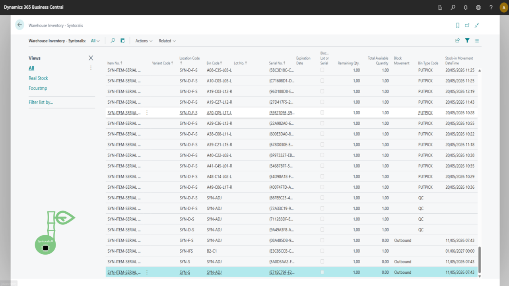
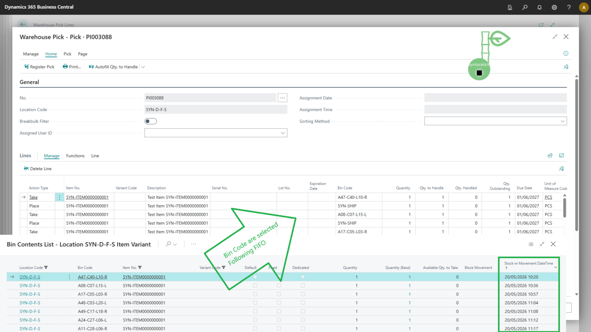
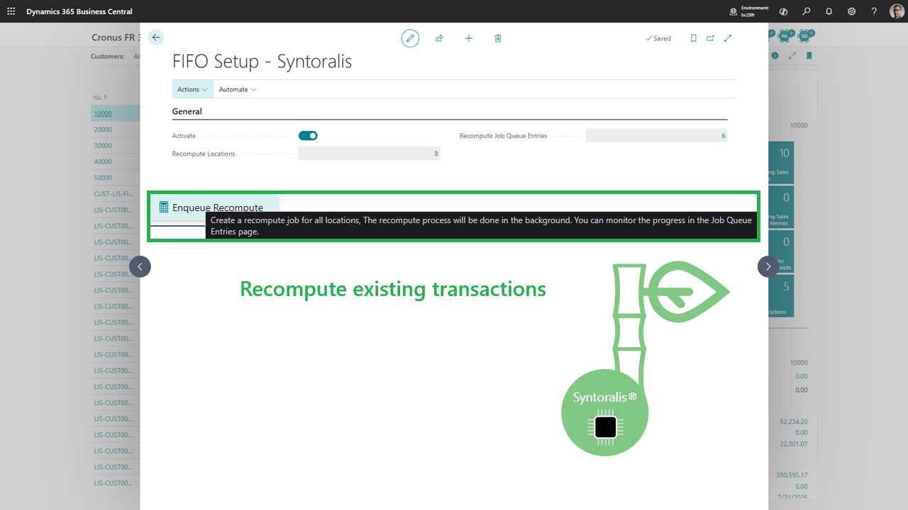

# Syntoralis FIFO Logistic

**Reliable FIFO picking for Business Central** — pick stock by actual stock-in date for warehouse picks, inventory picks, movements and replenishment. Compatible with lots, serial numbers and FEFO.



[Read the documentation](./index-en.html)

## Why standard FIFO isn't enough

Business Central selects stock by bin, not by real age. Result: uneven rotation, expiry risk, blocked lots, inventory discrepancies. Syntoralis FIFO Logistic replaces bin-based selection with **FIFO layer** selection (actual stock-in date/time), without changing your operational processes.

## What you gain

- **Perfect rotation**: oldest stock always leaves first.
- **FEFO respected**: compatible with expiration dates (First Expired First Out).
- **Traceability**: lots and serial numbers assigned automatically.
- **Zero operational change**: your pick documents stay the same.
- **Automatic splitting**: lines split according to available layers.

## Covered processes

- Warehouse Pick
- Inventory Pick
- Inventory Movement
- Replenishment for pick zones
- Lot-tracked and serial-tracked items
- Items with expiration dates (FEFO)

## Screenshots

## How it works

- **Install** from the Microsoft Marketplace (30-day free trial).
- **Configure** the locations involved (see [FIFO Setup](./setup-en.html)).
- **Pick**: the engine automatically selects the oldest FIFO layers.
- **Track**: remaining FIFO quantities updated in real time.

## Pricing & trial

- **30-day free trial** — no card required to start.
- Proprietary license, billed via the Microsoft Marketplace.
- Support included during the trial.



## Testimonials

> "FIFO rotation is finally reliable — no more inventory discrepancies." — *Pilot customer, distribution*

## FAQ

**Does the extension change costing?** No, valuation methods remain unchanged.

**Does it work with reservations?** Yes, standard reservation mechanisms keep working.

**Which objects are affected?** Location, Bin Content, Warehouse Entry, Warehouse Activity, Warehouse Pick, Inventory Pick, Inventory Movement, Lot No., Serial No.

## Ready to start?



[Full documentation](./index-en.html)

---

*Syntoralis EURL — software and responsible digital support.*