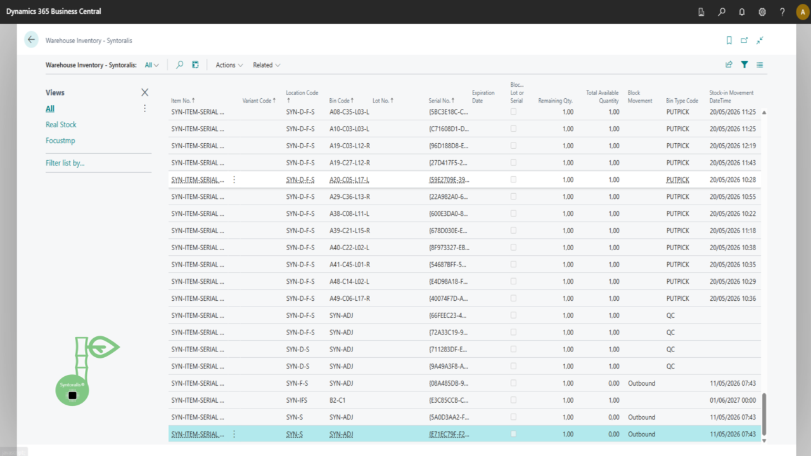
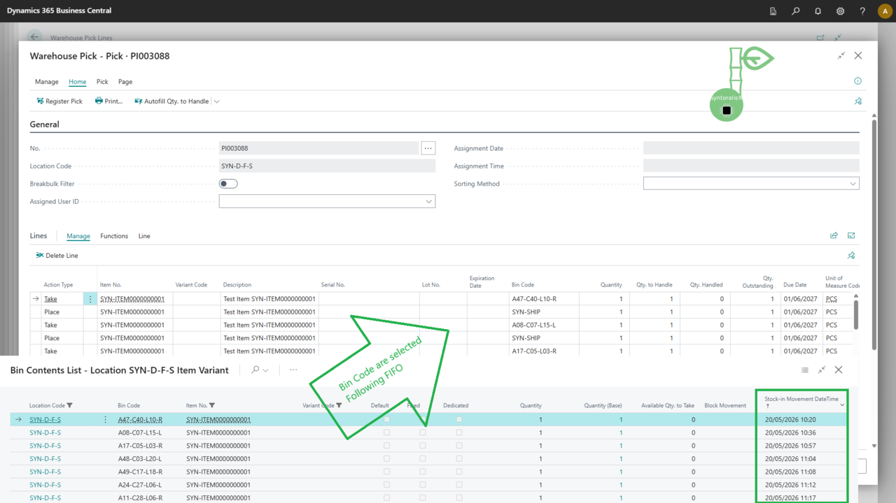
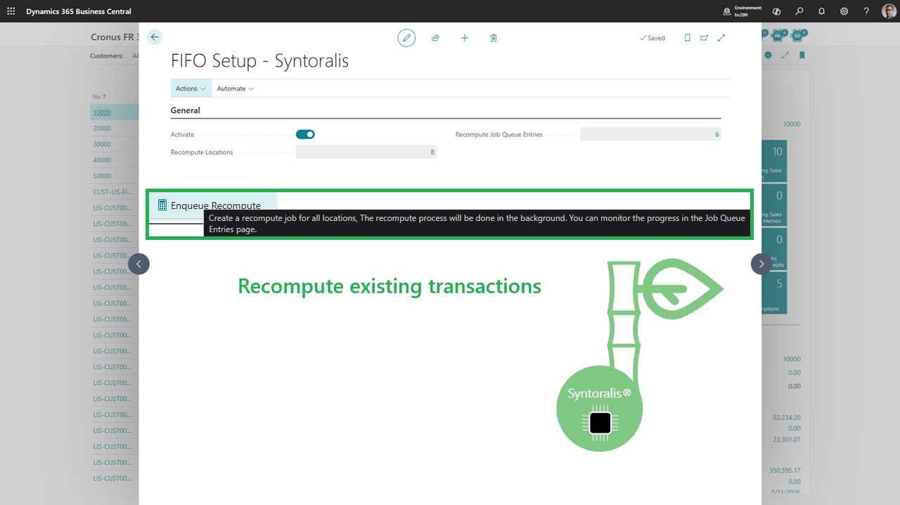

# Syntoralis FIFO Logistic

**Prélèvement FIFO fiable pour Business Central** — sélectionnez vos stocks selon la date réelle d'entrée en stock, pour les prélèvements entrepôt, inventaire, mouvements et réapprovisionnements. Compatible lots, numéros de série et FEFO.



[Lire la documentation](./index.html)

## Pourquoi le FIFO standard ne suffit pas

Business Central sélectionne les stocks par emplacement, pas par ancienneté réelle. Résultat : rotation inégale, risque de péremption, lots bloqués, écarts d'inventaire. Syntoralis FIFO Logistic remplace la sélection par emplacement par une sélection par **couche FIFO** (date/heure réelle d'entrée en stock), sans toucher à vos processus opérationnels.

## Ce que vous gagnez

- **Rotation parfaite** : les plus anciens stocks sortent toujours en premier.
- **FEFO respecté** : compatibilité avec les dates d'expiration (First Expired First Out).
- **Traçabilité** : lots et numéros de série affectés automatiquement.
- **Zéro changement opérationnel** : vos documents de prélèvement restent identiques.
- **Fractionnement automatique** : les lignes se scindent selon les couches disponibles.

## Processus couverts

- Prélèvement entrepôt (Warehouse Pick)
- Prélèvement inventaire (Inventory Pick)
- Mouvement inventaire (Inventory Movement)
- Réapprovisionnement des zones de prélèvement
- Articles suivis par lot et par numéro de série
- Articles avec date d'expiration (FEFO)

## Captures d'écran

## Comment ça marche

- **Installation** depuis le Microsoft Marketplace (essai gratuit 30 jours).
- **Paramétrage** des emplacements concernés (voir [Paramétrage FIFO](./setup.html)).
- **Prélèvement** : le moteur sélectionne automatiquement les couches FIFO les plus anciennes.
- **Suivi** : quantités FIFO restantes mises à jour en temps réel.

## Tarification & essai

- **Essai gratuit 30 jours** — aucune carte requise pour démarrer.
- Licence propriétaire, facturation via le Microsoft Marketplace.
- Support inclus pendant l'essai.



## Témoignages

> « La rotation FIFO est enfin fiable — plus d'écarts d'inventaire. » — *Client pilote, distribution*

## Questions fréquentes

**L'extension modifie-t-elle les coûts ?** Non, les méthodes de valorisation restent inchangées.

**Fonctionne-t-elle avec les réservations ?** Oui, les mécanismes standards de réservation continuent de fonctionner.

**Quels objets sont concernés ?** Location, Bin Content, Warehouse Entry, Warehouse Activity, Warehouse Pick, Inventory Pick, Inventory Movement, Lot No., Serial No.

## Prêt à commencer ?



[Documentation complète](./index.html)

---

*Syntoralis EURL — progiciels et accompagnement numérique responsable.*